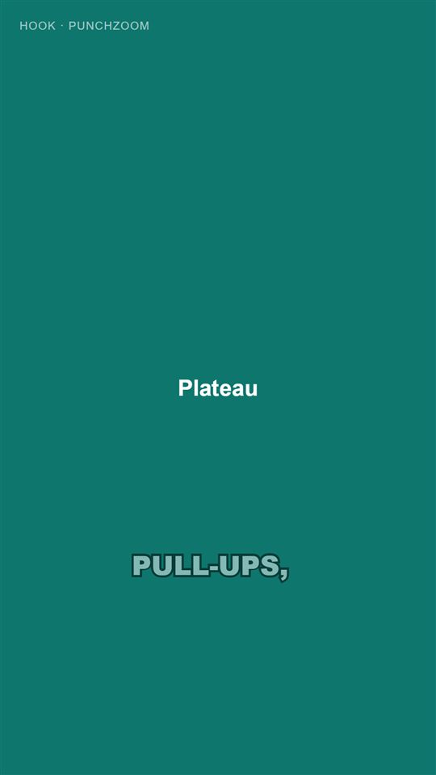
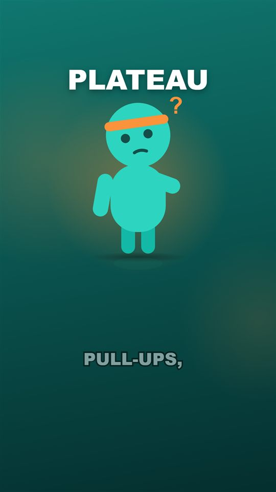
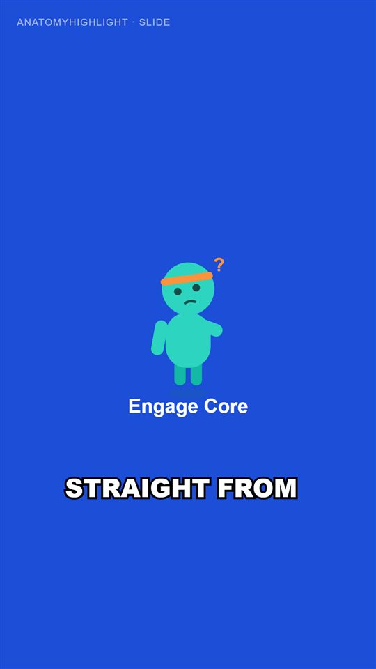
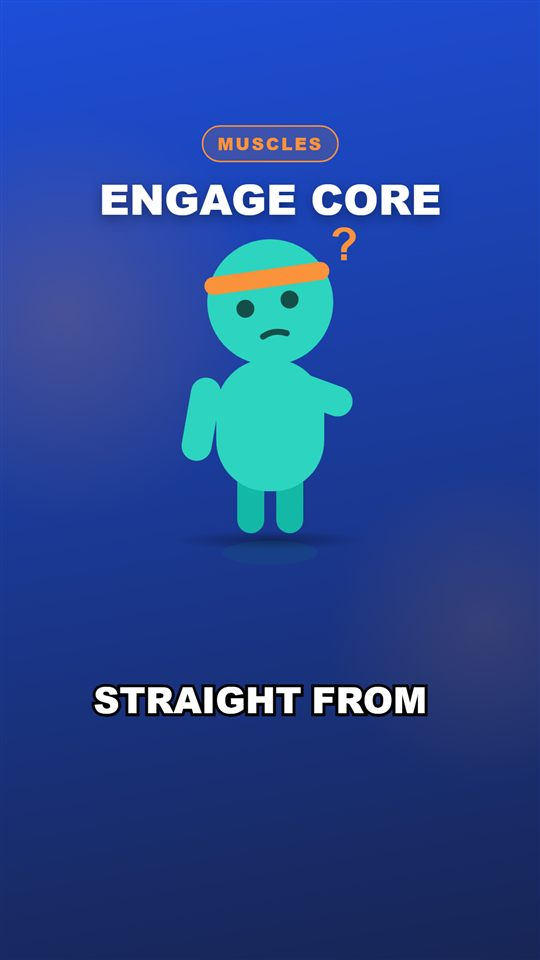
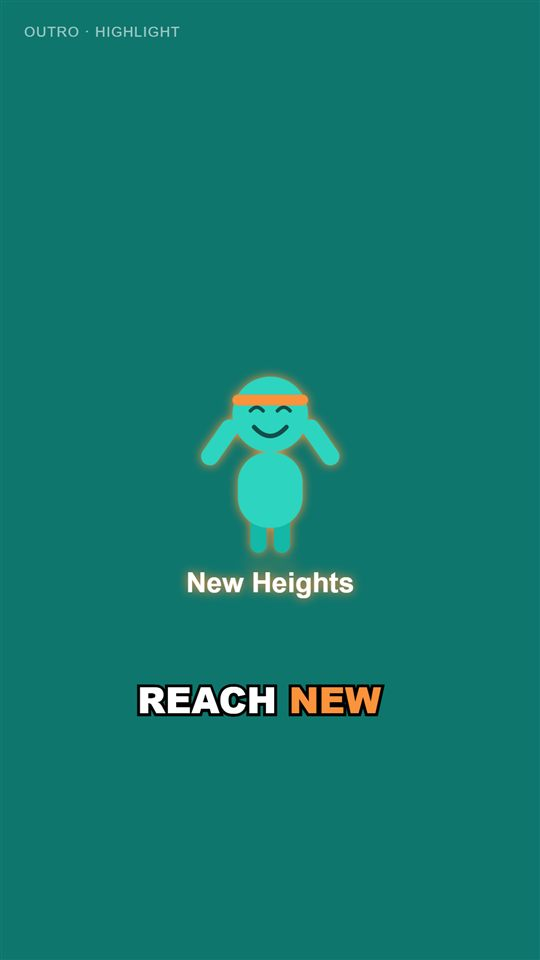
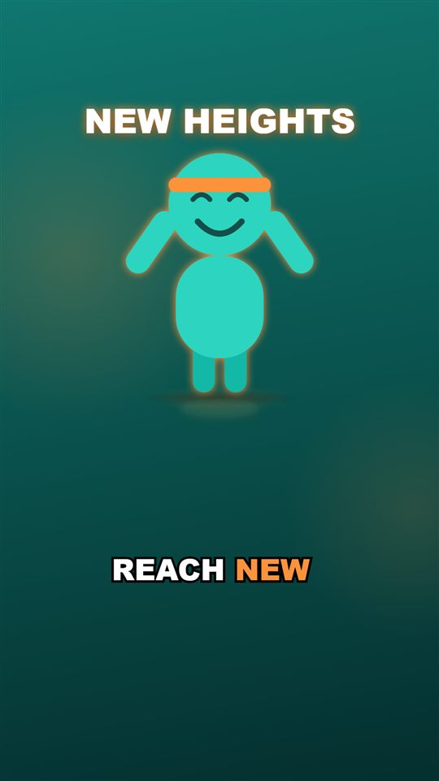
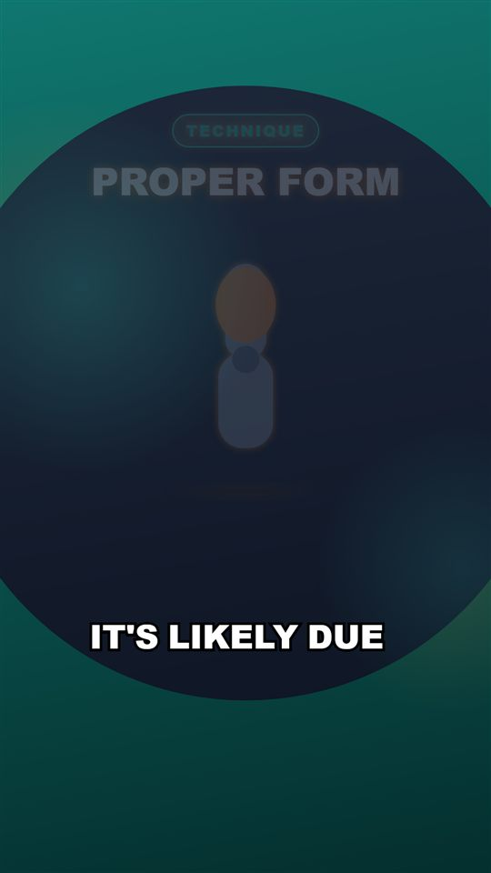

# Day 16 — Kod Notları

30 günlük roadmap, Gün 16. Konu: görsel kalite turu. Videonun "kodlama demosu" gibi değil, bilinçli tasarlanmış gibi görünmesi: hiyerarşi, tipografi, arka planlar, asset ölçeği, sahne geçişleri ve Hook enerjisi. Değişikliklerin neredeyse tamamı renderer'da. Backend'de sadece tek bir küçük kural değişti.

Bu doküman, bugün eklenen/değişen her kod parçasını **yazılma/kullanılma sırasına göre** gezer. Her parça için: kodun kendisi, **neden** böyle yazıldığı (mantık, çözdüğü gerçek problem) ve **nasıl** çalıştığı (syntax/teknik açıklama).

---

## 0. Önce / sonra

Aynı plan (Day 15'in gerçek job'ı `a903be2c-...`), aynı kareler:

| Kare | Önce | Sonra |
|---|---|---|
| 45 — Hook |  |  |
| 250 — AnatomyHighlight |  |  |
| 1010 — Outro |  |  |

Geçiş (kare 74, sahne 2'nin 5. karesi): 

Görülen farklar: Hook artık boş değil (yedek maskot + ışık patlaması). Sol üstteki `HOOK · PUNCHZOOM` geliştirici etiketi kalktı. Başlık büyüdü, büyük harf ve Arial Black. Sahnenin türünü söyleyen bir rozet var (`MUSCLES`). Asset 360 → 600 px ve zemin gölgesiyle oturuyor. Düz renkler gradyan + yavaş kayan ışık lekelerine dönüştü. Sahneler arasında dairesel bir açılma geçişi var.

---

## 1. `renderer/src/scenes/theme.ts` — tasarım kararları tek yerde

```ts
export const PALETTE_BY_SCENE_TYPE: Record<SceneType, ScenePalette> = {
  Hook: { from: "#0F766E", to: "#042F2E", accent: "#FB923C" },
  Comparison: { from: "#6D28D9", to: "#2E1065", accent: "#FBBF24" },
  ...
};
export const BADGE_BY_SCENE_TYPE: Record<SceneType, string | null> = {
  Hook: null, ExerciseDemo: "Technique", MythVsFact: "Myth vs fact", ..., Outro: null,
};
export const FALLBACK_ASSET_BY_SCENE_TYPE: Record<SceneType, string> = {
  Hook: "mascot-thinking", Recovery: "mascot-tired", Outro: "mascot-happy", ...
};
export function displayAssetId(scene: Scene): string {
  return scene.assetIds[0] ?? FALLBACK_ASSET_BY_SCENE_TYPE[scene.type];
}
```

**Neden:**
* **Palet**: sahne tipi başına iki duraklı bir gradyan (altta koyu, çünkü altyazılar orada) ve bir vurgu rengi. Arka arkaya gelen farklı tipteki sahneler, metin değişmeden önce bile "konu değişti" diye okunuyor.
* **Rozet**: başlığın üstünde küçük bir etiket, izleyiciye bu bölümün ne olduğunu söylüyor ("MYTH VS FACT", "PROGRESS"). Hook ve Outro'da yok: Hook'un başlığı tek başına vurmalı, Outro bir bölüm değil kapanış kartı.
* **Yedek asset**: Day 15'in Hook'u boş bir ekrandı, çünkü LLM asset seçmemişti. Artık her sahnede bir görsel var: plan bir asset seçmediyse orijinal maskot, sahneye uygun pozla (Hook → düşünen, Recovery → yorgun, Outro → mutlu) devreye giriyor. Bu bir **sunum** kararı, bu yüzden renderer'da. Backend'in planı değişmiyor.
* `Record<SceneType, ...>` (Day 9'daki gibi): yeni bir sahne tipi eklenip burada unutulursa TypeScript derlemiyor.

---

## 2. `SceneBackground.tsx` — senkronu bozmayan geçiş

```tsx
export const REVEAL_FRAMES = 12;

const radius = interpolate(frame, [0, REVEAL_FRAMES], [0, 150], { ...clamp, easing: Easing.inOut(Easing.cubic) });
return (
  <AbsoluteFill>
    {previous && radius < 150 ? <Layer palette={previous} ... /> : null}
    <AbsoluteFill style={{ clipPath: previous ? `circle(${radius}% at 50% 45%)` : undefined }}>
      <Layer palette={palette} ... />
    </AbsoluteFill>
  </AbsoluteFill>
);
```

**Neden:** Remotion'ın hazır geçiş sistemi (`<TransitionSeries>`) iki sahneyi geçiş süresince **üst üste bindirir** ve bu toplam süreyi kısaltır. Bizim sahne sürelerimiz ise Day 12'den beri narration'ın **gerçek zamanlaması**. Üst üste binme, görüntüyü sesten koparırdı. Bunun yerine her sahne bir önceki sahnenin arka planını en alta çiziyor ve kendi arka planını üstüne genişleyen bir daire olarak açıyor. Görünür bir geçiş var ve hiçbir sahneden zaman çalınmıyor. Kanıt: yeniden render edilen videonun süresi (34.667 sn) planla birebir aynı.

**Nasıl çalışıyor:**
* `clip-path: circle(r% at 50% 45%)`: katmanın sadece o dairenin içi görünür. `r` 12 karede 0'dan %150'ye büyüyor.
* `Layer`: gradyan + iki yumuşak ışık lekesi. Lekeler `Math.sin(frame / 45 + seed)` ile birkaç piksel kayıyor: ekran hiç "donmuş" görünmüyor ama dikkat de çekmiyor. `Math.random` yok, render deterministik (Day 9 kuralı).

### Bulunan ve düzeltilen hata: görünmeyen geçiş

İlk sürüm 9 kare + `Easing.out` idi. Kare kare bakınca geçişin **2. karede bitmiş** olduğu görüldü. Sebep: `circle()` içindeki yüzde, ekranın **köşegenine** göre hesaplanıyor (1080×1920 için ~1555 px). `Easing.out` ilk karelerde çok hızlı büyüdüğü için yarıçap 2. karede zaten %80'i (~1240 px) geçip bütün ekranı kaplıyordu. 12 kare + `Easing.inOut` (yavaş başla, hızlan, yavaş bitir) ile kare 74'te (geçişin 5. karesi) daire açıkça görülüyor.

---

## 3. `SceneView.tsx` — hiyerarşi (Day 8 dosyası, yeniden yazıldı)

```
yukarıdan aşağıya, Shorts safe area içinde:
  rozet (ne tür bir bölüm)  ->  başlık (sahnenin tek fikri)  ->  görsel (600 px + zemin gölgesi)
  ... altyazılar ayrı katmanda (CaptionRenderer, Day 10)
```

```tsx
const contentFrame = Math.max(0, frame - (previousPalette ? CONTENT_DELAY_FRAMES : 0));   // 2 kare
const animation = getAnimation(scene.animation, { frame: contentFrame, fps, durationInFrames });
...
fontSize: isHook ? 108 : 84, textTransform: "uppercase", fontFamily: "Arial Black, ...",
...
{isHook ? <div style={{ background: `radial-gradient(circle, ${accent}66 ...)`, transform: `scale(${burst})` }} /> : null}
```

**Neden:**
* **Üç metin rolü ayrışıyor**: rozet = bağlam, başlık = çıkarılacak ders, altyazı = şu an söylenen. Önceden başlık ile altyazı aynı boyutta ve yakın konumdaydı, göz hangisini okuyacağını bilmiyordu.
* **Hook enerjisi**: Hook'ta görselin arkasında vurgu renginde bir ışık patlaması var. `Easing.back(2)` ile hafifçe büyüyüp yerine oturuyor, sonra yavaşça "nefes alıyor". Hook başlığı diğerlerinden büyük (108 px).
* **Geliştirici etiketi kaldırıldı** (Day 8'den beri "Day 16'da kaldırılacak" diye bekliyordu).
* **İçerik gecikmesi 2 kare**: içerik, arka plan açılmaya başladıktan hemen sonra girmeye başlıyor. Böylece geçiş ve giriş animasyonu tek bir hareket gibi okunuyor. İlk denediğim 4 kare, her kesmede gözle görülür boş bir an bırakıyordu.

---

## 4. `SceneRenderer.tsx` ve `ShortComposition.tsx` (değişti)

```diff
-      {orderedScenes.map((scene) => {
+      {orderedScenes.map((scene, index) => {
+        const previous = index > 0 ? orderedScenes[index - 1] : null;
         ...
-            <SceneView scene={scene} assetSvgById={assetSvgById} durationInFrames={durationInFrames} />
+            <SceneView scene={scene} index={index}
+                       previousPalette={previous ? PALETTE_BY_SCENE_TYPE[previous.type] : null} ... />
```
```diff
-  const allAssetIds = plan.scenes.flatMap((scene) => scene.assetIds);
+  const allAssetIds = [...new Set(plan.scenes.map(displayAssetId))];
```

**Neden:** Geçiş için her sahnenin bir öncekinin paletini bilmesi gerekiyor. `<Series>` bir önceki sahneyi ekrandan kaldırdığı için bu bilgi yukarıdan, sıralı listeden veriliyor. `calculateMetadata` artık sahnelerin **gösterilecek** asset'lerini (yedekler dahil) yüklüyor. `Set` ile aynı SVG iki kez okunmuyor.

---

## 5. Backend: `counter` + sayısız metin → `pop` (Day 15 dosyası, küçük değişiklik)

```csharp
private static AnimationId ResolveAnimation(AnimationId? requested, string? onScreenText) =>
    requested switch
    {
        null => AnimationId.Fade,
        AnimationId.Counter when onScreenText is null || !onScreenText.Any(char.IsAsciiDigit) => AnimationId.Pop,
        _ => requested.Value,
    };
```

**Neden:** Day 15 videosunda LLM, `"Wrong Muscle"` metnine `counter` animasyonu vermişti. `counter` metindeki ilk sayıyı sıfırdan saydırır. Sayı yoksa hiçbir şey yapmaz, sahne animasyonsuz kalır. Hook/Outro zorlamasıyla aynı mantık: bu bir kural düzeltmesi, deneme harcamaya değmez. `pop`, görünür hareketi olan en yakın giriş animasyonu.

**Nasıl çalışıyor:** C# `switch` ifadesinde `when` koşulu (pattern + guard). `char.IsAsciiDigit` sadece 0–9'u kabul ediyor.

---

## 6. Önce/sonra görüntüleri

`docs/images/day-16/` altındaki kareler önce PNG olarak alındı. Gradyanlı "sonra" kareleri ~1.4 MB tutuyordu (toplam ~5.6 MB), dokümantasyon için gereğinden büyük. Windows'un yerleşik `System.Drawing` kütüphanesiyle 540×960'a küçültülüp %82 kaliteli JPEG yapıldı (her biri 15–30 KB). Yeni bir araç kurulmadı.

---

## Doğrulanan davranış

```
$ dotnet test
Başarılı! - Başarısız: 0, Başarılı: 57 - ShortsGenerator.Domain.Tests.dll
Başarılı! - Başarısız: 0, Başarılı: 70 - ShortsGenerator.Application.Tests.dll   (+1: counter -> pop)
Başarılı! - Başarısız: 0, Başarılı: 61 - ShortsGenerator.Infrastructure.Tests.dll
Başarılı! - Başarısız: 0, Başarılı:  7 - ShortsGenerator.Api.Tests.dll
(toplam 195)

$ cd renderer; npm run lint -> eslint + tsc temiz;  npm test -> 26/26
```

Gerçek job'ın API üzerinden yeniden render'ı (`POST /api/videos/a903be2c-.../render` → `202`, kuyruk → `Completed`, 28 sn):
```
getVideoMetadata(final.mp4) -> {"w":1080,"h":1920,"fps":30,"dur":34.667,"v":"h264","a":"aac"}
plan.json targetDurationSeconds -> 34.666666...
```

Bu çıktılar şunu kanıtlıyor: önce/sonra karşılaştırması (roadmap kabul kriteri) belirgin bir fark gösteriyor. Geçişler eklenmesine rağmen video süresi sesin süresiyle birebir aynı kaldı, senkron korunuyor. Bir de not: 4 kare görüntüyü kontrol ederken `remotion still`'in eski bir bundle'ı (`build/`) kullandığı fark edildi ve yeniden bundle alındı. API'nin render'ları her seferinde kaynaktan bundle aldığı için bundan etkilenmiyor.

**Bilinçli olarak bırakılanlar:** sahne tipleri hâlâ aynı yerleşimi paylaşıyor, sadece renk ve rozet değişiyor. Tipe özel şablonlar (MythVsFact kartı, karşılaştırma bölmesi, liste) Day 18'in konusu. Asset'lerin anlamsal uygunluğu (ör. "Proper Form" için biceps şeması) ve asset sayısı Day 19/20'de.
