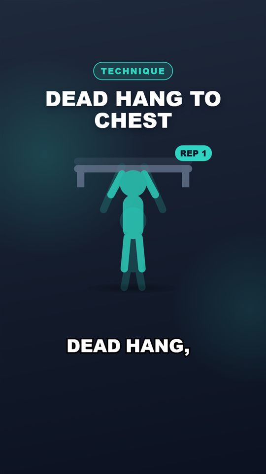
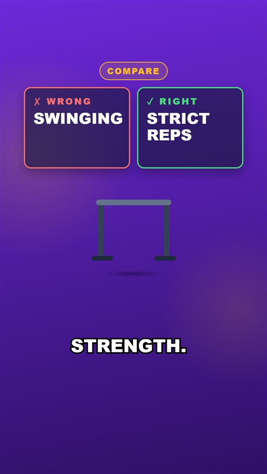
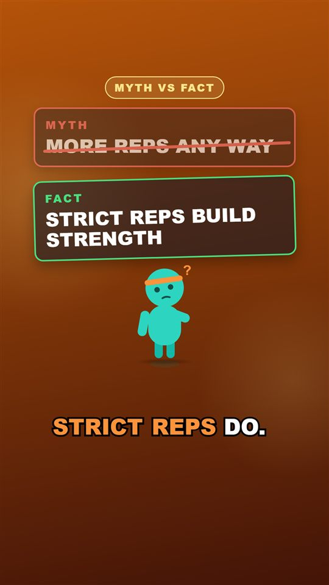
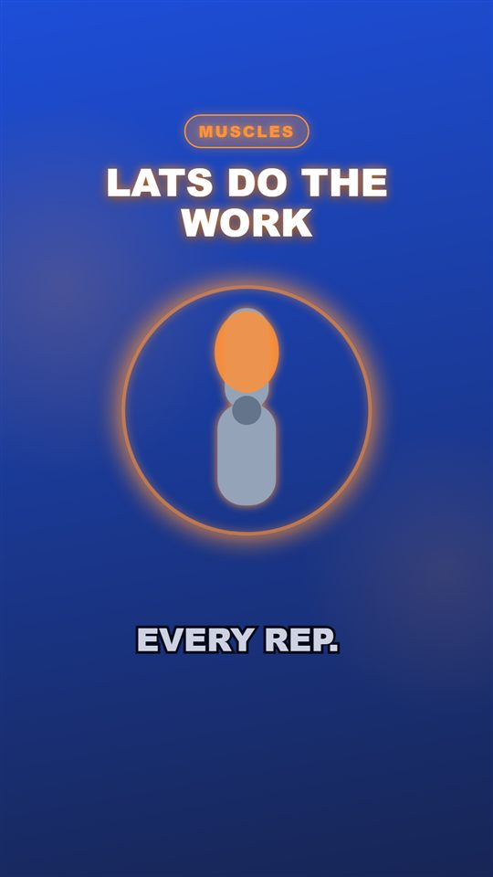
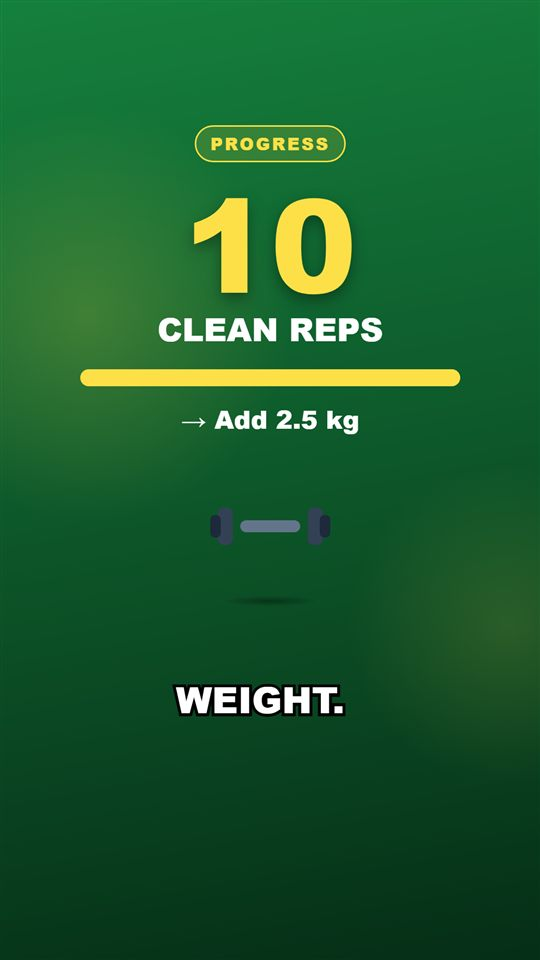
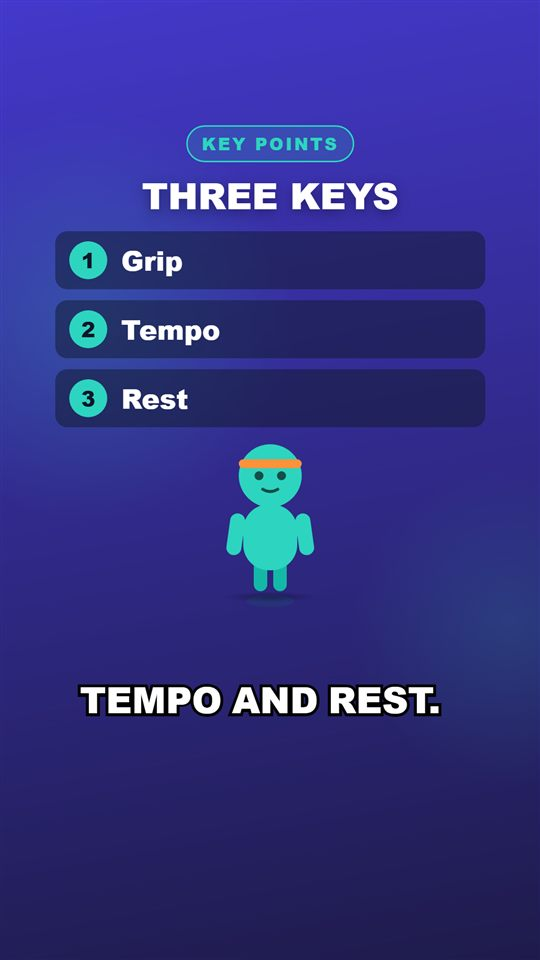
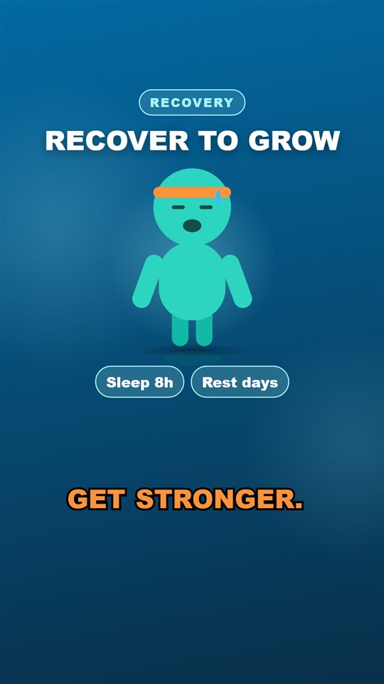
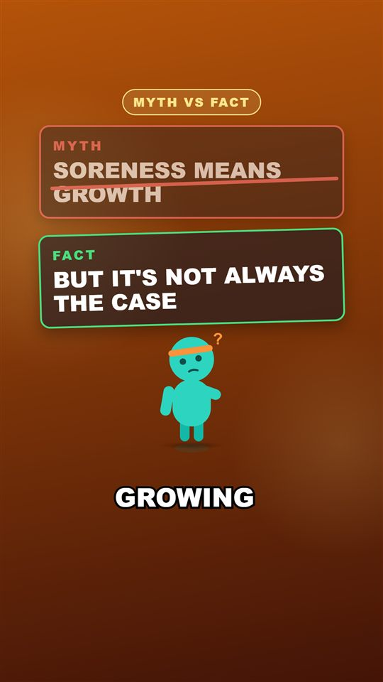
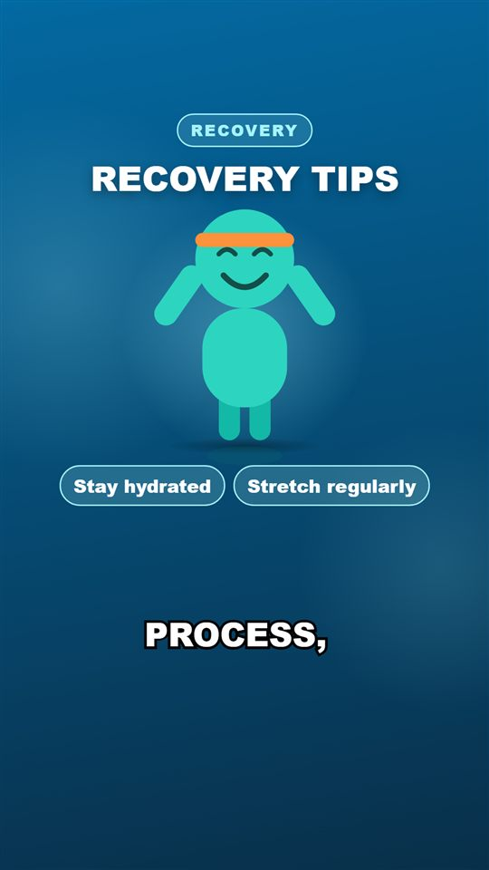
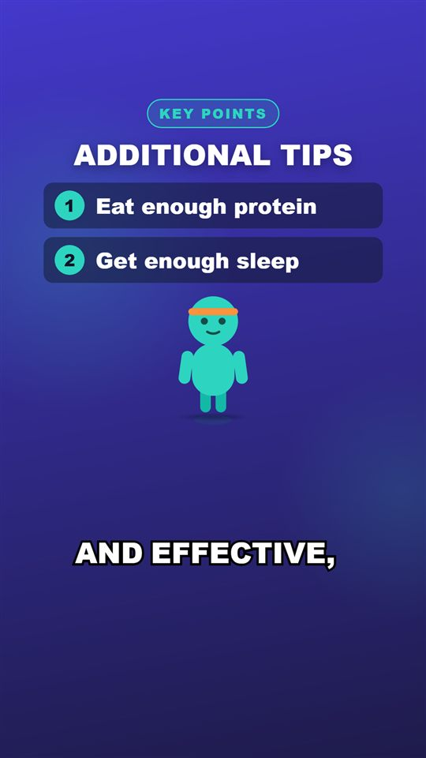

# Day 18 — Kod Notları

30 günlük roadmap, Gün 18. Konu: fitness'a özel sahne şablonları. Her sahne tipi artık kendi yerleşimine sahip: MythVsFact, Comparison, List, Progress, AnatomyHighlight (kas vurgusu), ExerciseDemo (tekrar animasyonu), Recovery. Bunun için plan sözleşmesine iki opsiyonel alan eklendi, ve gerçek LLM çıktısında görülen iki içerik sorunu düzeltildi.

Bu doküman, bugün eklenen/değişen her kod parçasını **yazılma/kullanılma sırasına göre** gezer. Her parça için: kodun kendisi, **neden** böyle yazıldığı (mantık, çözdüğü gerçek problem) ve **nasıl** çalıştığı (syntax/teknik açıklama).

---

## 0. Şablonlar (örnek plan `samples/template-showcase-plan.json`)

| ExerciseDemo | Comparison | MythVsFact | AnatomyHighlight |
|---|---|---|---|
|  |  |  |  |

| Progress | List | Recovery |
|---|---|---|
|  |  |  |

Gerçek bir LLM planından (`Why Soreness Doesn't Mean Muscle Growth`):

| MythVsFact | Recovery | List |
|---|---|---|
|  |  |  |

---

## 1. Sözleşme: `Scene.SecondaryText` ve `Scene.Items` (Domain, değişti)

```diff
     double? SpokenDurationSeconds = null,
+    string? SecondaryText = null,
+    IReadOnlyList<string>? Items = null);
```

**Neden:** Tek bir `onScreenText` alanı, iki tarafı olan şablonlar için yetersiz. Mit/gerçek, yanlış/doğru, "10 tekrar" → "ne kazandırır", ya da 2–3 maddelik bir liste ifade edilemiyor. İki alan da **opsiyonel ve varsayılanı null**: eski planlar, el yazımı örnekler ve renderer'ın Zod şeması (`.optional()`) değişmeden çalışmaya devam ediyor.

---

## 2. LLM tarafı: şema, prompt ve temizleme (Day 15/17 dosyaları, değişti)

```csharp
// VisualPlanSchema: her sahnede zorunlu, ama boş olabilir
["secondaryText"] = { "type": ["string", "null"] },
["items"]         = { "type": "array", "maxItems": 3, "items": { "type": "string" } },
```
Prompt, her tipin hangi alanları kullandığını örneklerle anlatıyor:
```
* MythVsFact: onScreenText = the myth itself, secondaryText = the fact itself (max 5 words each),
  e.g. "More reps always" / "Strict reps build strength". The card already says MYTH and FACT -
  never write the words "myth", "fact", "wrong way" or "right way" in the text.
* Comparison: onScreenText = the mistake, secondaryText = the fix, e.g. "Sagging hips" / "Straight body line".
* List / Recovery: onScreenText = a short title, items = 2-3 tips of max 4 words each.
* Progress: onScreenText contains a number (e.g. "10 clean reps"), secondaryText = what it unlocks.
  Use several different types across the video.
```
```csharp
SecondaryText: CleanCardText(visual.SecondaryText),
Items: CleanItems(visual.Items),          // trim, boşları at, en fazla 3, hiç kalmadıysa null
```

**Neden "zorunlu ama boş olabilir":** Şemada alan zorunlu olunca model onu **düşünmek zorunda** kalıyor (null veya boş dizi yazsa bile). Opsiyonel bırakılsaydı küçük model büyük ihtimalle hep atlardı.

### Bulunan ve düzeltilen hata: kart etiketinin metne yazılması

İlk gerçek çalıştırmada (`Can You Build Muscle With Push-Ups?`) model şunları yazdı:
```
2 MythVsFact  'Common myth' sec='Fact: engaging core'
6 Comparison  'Wrong way'   sec='Right way: engaging core'
```
Şablonlar kartları zaten **MYTH / FACT**, **✗ WRONG / ✓ RIGHT** diye etiketliyor. Bu haliyle ekranda "FACT / FACT: ENGAGING CORE" gibi çift etiket görünecekti. "Wrong way" ise hiçbir bilgi taşımıyor.

**Düzeltme (iki katmanlı):**
```csharp
private static string? CleanCardText(string? text)
{
    var cleaned = CardLabelPrefix().Replace(text.Trim(), "").Trim();       // "Fact: x" -> "x"
    return cleaned.Length == 0 || CardLabelOnly().IsMatch(cleaned) ? null : cleaned;   // "Wrong way" -> null
}
[GeneratedRegex(@"^(myth|fact|truth|wrong(\s+way)?|right(\s+way)?|correct(\s+way)?)\s*[:\-–—]\s*", IgnoreCase)]
[GeneratedRegex(@"^(common\s+)?(myth|fact|truth|wrong(\s+way)?|right(\s+way)?|correct(\s+way)?)$", IgnoreCase)]
```
1. **Prompt**: somut örnekler + "bu kelimeleri yazma" kuralı.
2. **Kod**: yine de yazılırsa önek temizleniyor. Metin sadece bir etiketten ibaretse `null` yapılıyor, şablon tek karta düşüyor (bölüm 3). Önek regex'i bir ayraç (`:`, `-`, `–`) şartı koyuyor, bu yüzden "Factory reset your form" gibi meşru bir metne dokunulmuyor (test edildi).

İkinci gerçek çalıştırmada (`Why Soreness Doesn't Mean Muscle Growth`) sonuç: `'Soreness means growth' / 'But it's not always the case'`. Etiket öneki yok, ifade de temkinli (`CLAUDE.md` §4).

---

## 3. Renderer: şablon mimarisi

```
scenes/SceneView.tsx            arka plan + geçiş (Day 16) + tipine göre şablon
scenes/templates/
  index.ts                      TEMPLATE_BY_SCENE_TYPE: Record<SceneType, React.FC<TemplateProps>>
  shared.tsx                    TemplateProps, Badge, Headline, AssetView, Card, Column
  staging.ts                    konuşmaya göre zamanlama + poz eşleme (saf fonksiyonlar, test edildi)
  GenericTemplate.tsx           Hook, Outro ve eksik veride yedek (Day 16 yerleşimi)
  MythVsFactTemplate.tsx, ComparisonTemplate.tsx, ListTemplate.tsx, ProgressTemplate.tsx,
  AnatomyTemplate.tsx, ExerciseDemoTemplate.tsx, RecoveryTemplate.tsx
```
```tsx
// SceneView.tsx
const Template = TEMPLATE_BY_SCENE_TYPE[scene.type];
return (<AbsoluteFill>
  <SceneBackground ... />
  <Template scene={scene} frame={contentFrame} ... animation={getAnimation(...)} />
</AbsoluteFill>);
```

**Neden:**
* **Strategy pattern'in UI hali**: `SceneView` hangi şablonun ne çizdiğini bilmiyor, sadece seçiyor. Yeni bir şablon = yeni bir dosya + `Record`'a bir satır.
* **Exhaustive `Record<SceneType, ...>`** (Day 9/16 deseni): şemaya yeni bir sahne tipi eklenip şablonu unutulursa derleme hatası.
* **Her şablonun bir yedeği var**: veri eksikse (fact'siz bir MythVsFact, maddesiz bir List, sayısız bir Progress) şablon `GenericTemplate`'e düşüyor. LLM çıktısı ne kadar eksik olursa olsun render asla bozulmuyor, sadece daha sade bir kart çıkıyor.
* **Ortak parçalar `shared.tsx`'te**: rozet, başlık, kart, asset görünümü ve içerik sütunu tek yerde. Şablonlar sadece kendi farklarını içeriyor.

---

## 4. `staging.ts` — konuşmaya göre zamanlama

```ts
export function spokenFrames(spokenDurationSeconds, fps, durationInFrames): number   // Day 12 verisi
export function revealAt(frame, startFrame, frames = 8): number                       // 0 -> 1, eased
export function itemStartFrame(index, count, spoken): number    // maddeleri konuşmanın ilk %80'ine yay
export function poseCounterpart(assetId): string | null         // "pullup-top" <-> "pullup-bottom"
export function repPose(frame, fps, repSeconds = 1.4): { top, reps }
export function splitLeadingNumber(text): { before, value, after } | null
```

**Neden:** Şablonların parçaları, narration'da söylendikleri anda ortaya çıkıyor: mit söylenirken üstü çiziliyor (%30), gerçek damga gibi geliyor (%40), liste maddeleri sırayla beliriyor. Day 12'de her sahne için ölçülen `spokenDurationSeconds` burada ikinci kez işe yarıyor. Hepsi saf fonksiyon, bu yüzden Vitest ile test edildi (6 test).

---

## 5. Şablonlar tek tek

* **MythVsFact**: kırmızı "MYTH" kartı → konuşmanın %30'unda soldan sağa çizilen bir üstü çizgi + kart solar → %40'ta yeşil "FACT" kartı 1.25 ölçek ve −6° açıdan **damga** gibi yerine oturuyor (−1.5° eğik kalıyor, el basılmış hissi).
* **Comparison**: ✗ kırmızı ve ✓ yeşil kartlar yan yana. Doğru kart %35'te sağdan kayarak geliyor.
* **List**: başlık + numaralı satırlar. Her satır sırasıyla soldan kayarak giriyor.
* **Progress**: `splitLeadingNumber` ile "10 clean reps" metninden sayı ayrılıyor, 260 px büyüklüğünde sayılıyor, aynı anda bir çubuk doluyor, sonra "→ Add 2.5 kg" beliriyor. `fontVariantNumeric: "tabular-nums"`: rakamlar eşit genişlikte, böylece sayı 9 → 10'a geçerken yana kaymıyor (Day 9'dan beri bilinen sorun çözüldü).
* **AnatomyHighlight**: kas şeması büyük, arkasında saniyede ~0.8 kez nabız gibi atan bir vurgu halkası.
* **ExerciseDemo**: egzersiz asset'leri poz çiftleri halinde (`pullup-top`/`pullup-bottom`). İkisi arasında gidip gelmek, iki sabit çizimi bir **tekrara** dönüştürüyor. Köşedeki rozet tekrarları sayıyor (`REP 1, 2, ...`). Bir animasyon iskeleti (rig) kurmadan elde edilebilecek en ucuz hareket (`CLAUDE.md` §20: "tam bir vektör rigging sistemi kurma"). `calculateMetadata`, planda sadece `pullup-bottom` olsa bile eşini `resolveOptionalAssetSvgs` ile yüklüyor. Eşi yoksa sessizce tek resim kalıyor, render başarısız olmuyor.
* **Recovery**: 4 saniyelik bir "nefes" döngüsüyle büyüyüp küçülen yumuşak bir daire + maddeler numarasız, yumuşak "çip"ler halinde. Kasıtlı olarak sakin.

### Bulunan ve düzeltilen: poz geçişinde hayalet görüntü

İlk sürümde pozlar arasında 5 karelik çapraz geçiş (crossfade) vardı. Geçişin ortasına denk gelen karede iki çizim üst üste ve **bar iki kez** görünüyordu. Sebep: iki poz çiziminde bar aynı yükseklikte değil (çizimler aynı noktaya hizalı değil). Geçiş 2 kareye indirildi: hareket net bir "flipbook" gibi okunuyor, hayalet görüntü göz kırpması kadar kısa. Çizimlerin hizalanması asset araçları gününe (Day 20) bırakıldı.

---

## 6. Bulunan ve düzeltilen: altyazı titremesi (Day 10 dosyası, değişti)

```diff
-        opacity: entrance,
+        opacity: 0.5 + 0.5 * entrance,
```

Gerçek job'dan alınan bir karede altyazı yoktu. 4 kare sonrasında vardı. Sebep: o kare tam bir altyazı parçasının **ilk karesiydi** ve giriş animasyonu opaklığı 0'dan başlatıyordu. Altyazı parçaları aynı karede değiştiği için, **her parça değişiminde bir karelik boş altyazı** oluşuyordu. 30 fps'de bu bir titreme olarak algılanır. Giriş artık 0.5'ten başlıyor: yumuşak giriş korunuyor, boş kare kalmıyor. Aynı kare yeniden render edildiğinde altyazı (`GROWING`) görünüyor.

---

## 7. Testler

* .NET (+8): şablon alanlarının taşınması ve temizlenmesi (boşluklar, boş metin → null, madde temizliği + en fazla 3); etiket öneki temizleme (6 vaka: `Fact:`, `Right way:`, `MYTH -`, sadece "Wrong way", "Common myth", ve dokunulmaması gereken "Factory reset your form").
* Renderer `staging.test.ts` (6): konuşma süresi sınırları; `revealAt` monotonluğu; madde zamanlaması (0, 24, 48); poz eşleme; tekrar pozu ve sayımı; sayı ayırma.

---

## Doğrulanan davranış

```
$ dotnet test           -> Domain 57, Application 83, Infrastructure 61, Api 7  (toplam 208; Day 17'de 201)
$ cd renderer; npm test -> 38 passed;  npm run lint -> temiz
```

İki gerçek uçtan uca üretim (Ollama + Kokoro + Remotion, ikisi de planı **ilk denemede** kabul etti):
```
"Can You Build Muscle With Push-Ups?"      Completed in 61s, 7 sahne
  Hook, MythVsFact, AnatomyHighlight, ExerciseDemo [pushup-bottom], Progress '10 clean reps', Comparison, Outro

"Why Soreness Doesn't Mean Muscle Growth"  Completed in 60s, 8 sahne
  1 Hook             'max reps'
  2 AnatomyHighlight 'biceps'
  3 MythVsFact       'Soreness means growth' / 'But it's not always the case'
  4 Comparison       'Soreness vs. Progress' / 'Progress, not pain'
  5 Recovery         'Recovery tips'  items=[Stay hydrated | Stretch regularly]
  6 Progress         '10 clean reps' / 'Unlocks stronger muscles'
  7 List             'Additional tips' items=[Eat enough protein | Get enough sleep]
  8 Outro            'Train smart, not hard'
```

Bu çıktılar şunu kanıtlıyor: tek bir plan, gözle görülür şekilde farklı birçok şablonu karıştırıyor (ikinci planda 8 sahnede 7 farklı tip; roadmap kabul kriteri). Şablonlar eksik veride bozulmadan sade karta düşüyor. Gerçek çıktıda bulunan iki içerik/görüntü sorunu (çift etiket, altyazı titremesi) aynı gün düzeltildi.

**Görülen ve sonraki günlere bırakılanlar:** asset seçimleri hâlâ zayıf (Hook'ta "max reps" için dumbbell, "Recovery tips" için mutlu maskot; Day 19/20). Comparison'ın "Soreness vs. Progress" gibi bir başlığı sol kartta "yanlış" olarak görünüyor (model alanı yanlış kullanmış). Day 19'daki çeşitlilik/kalite kontrolleri için not.
