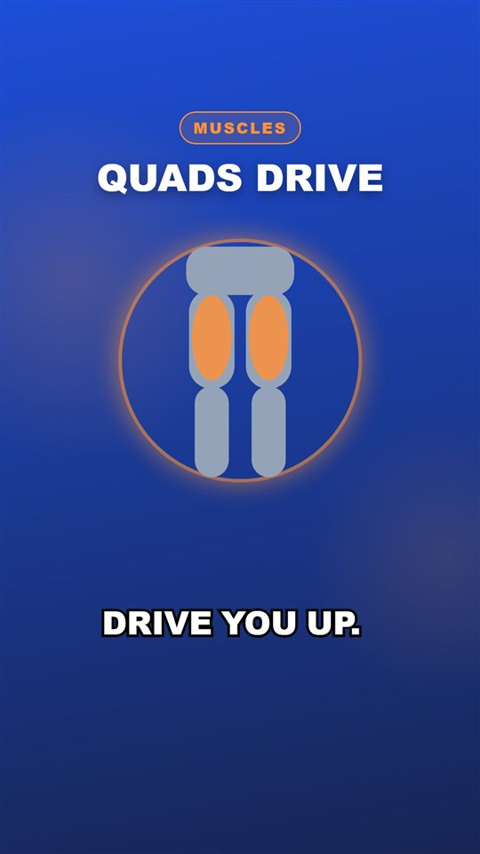
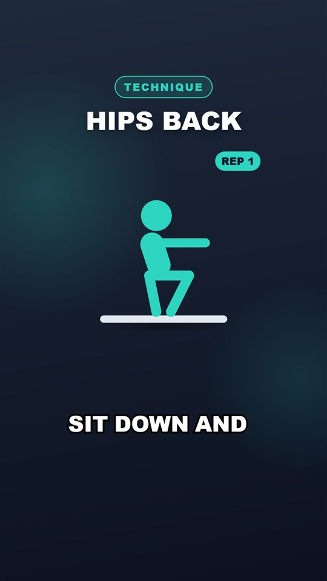
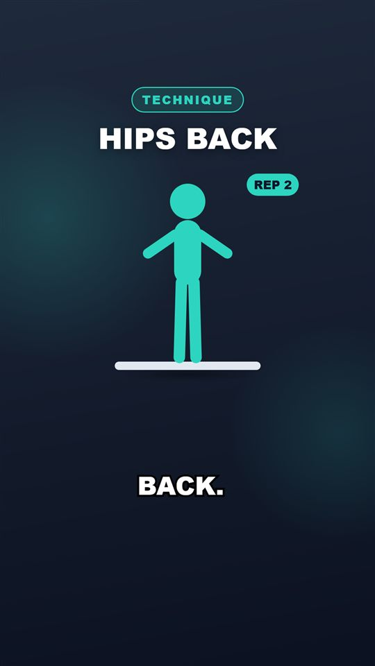
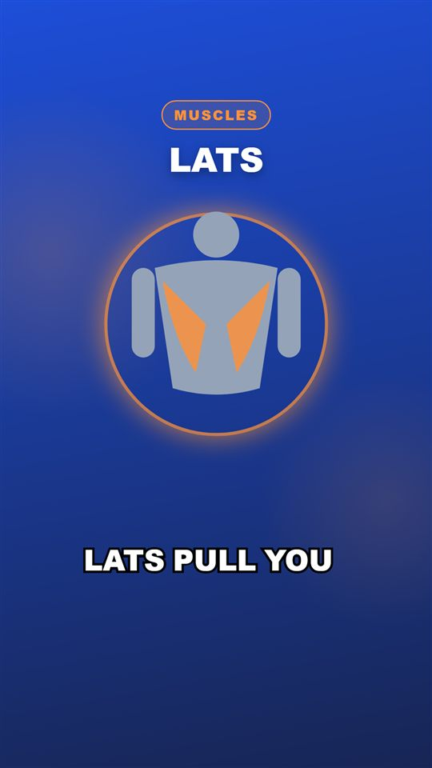
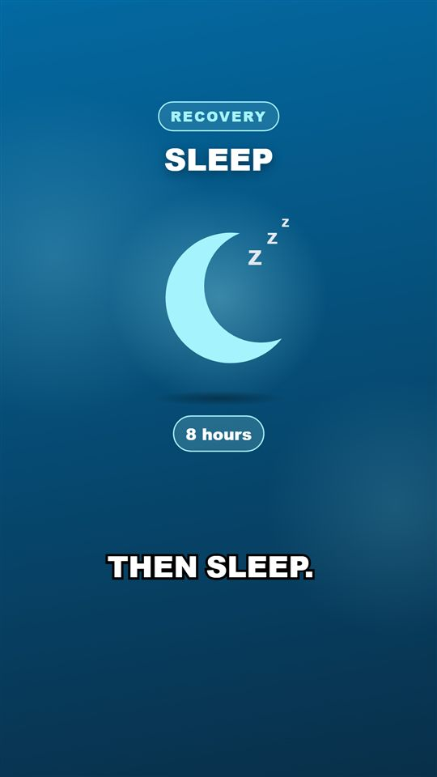

# Day 20 — Kod Notları

30 günlük roadmap, Gün 20. Konu: asset kütüphanesi genişletme araçları. Bir komut satırı aracı (`validate` / `add` / `replace` / `index`), SVG güvenlik kontrolleri, isimlendirme kuralları (`docs/ASSETS.md`), 10 yeni orijinal asset, ve asset seçimini katalog etiketleriyle iyileştiren deterministik bir eşleştirici.

Bu doküman, bugün eklenen/değişen her kod parçasını **yazılma/kullanılma sırasına göre** gezer. Her parça için: kodun kendisi, **neden** böyle yazıldığı (mantık, çözdüğü gerçek problem) ve **nasıl** çalıştığı (syntax/teknik açıklama).

---

## 1. Poz hizalaması (Day 18 teknik borcu)

```diff
 <!-- pullup-top.svg -->
-  <rect x="20" y="30" width="160" height="10" rx="5" fill="#64748B"/>     bar y=30
+  <rect x="20" y="20" width="160" height="10" rx="5" fill="#64748B"/>     bar y=20 (pullup-bottom ile aynı)
   ... figürün bütün y koordinatları 10 birim yukarı
```

**Neden:** Day 18'deki tekrar animasyonu iki pozu dönüşümlü gösteriyor. Bar iki çizimde farklı yükseklikteydi, bu yüzden geçişte bar "zıplıyor" ve hayalet görüntü oluşuyordu. Artık sabit nesneler (bar, zemin) iki pozda aynı koordinatta, sadece figür hareket ediyor. Bu kural `docs/ASSETS.md`'ye "kayıtlı poz çiftleri" (registered pose pairs) olarak yazıldı. Push-up çifti zaten hizalıydı (zemin y=160).

---

## 2. `Infrastructure/Assets/AssetManifestValidator.cs` — tek yerde bütün kurallar

```csharp
public static AssetValidationReport Validate(string manifestPath)
// HATA:  geçersiz JSON | tekrar eden id | id biçimi (^[a-z0-9][a-z0-9-]*$) | bilinmeyen kategori
//        | etiket yok | yol assets/ dışına çıkıyor | dosya yok | SVG kuralları (aşağıda)
//        | renderer'ın yedek maskotları (mascot-idle/thinking/happy/tired) eksik
// UYARI: etiket biçimi | uyumlu sahne tipi yok | poz çiftinin yarısı eksik ("squat-top" var, "squat-bottom" yok)
//        | manifest'te olmayan "yetim" SVG dosyası

public static IReadOnlyList<string> ValidateSvg(string path)
// .svg değil | > 200 kB | <svg> kökü yok | viewBox yok
// <script> | on*= olay öznitelikleri | javascript: | <foreignObject>/<iframe>/<embed>/<object>
// href/src = "http(s):..." / "//..." / "data:text..."
```

**Neden — SVG'ler aslında kod:** Renderer, SVG içeriğini sayfaya `dangerouslySetInnerHTML` ile **olduğu gibi** gömüyor (Day 8). İçinde `<script>` ya da `onload="..."` olan bir SVG, render sırasında headless Chrome'da çalışan kod demek. Bugüne kadar bu güvenliydi, çünkü bütün SVG'leri biz elle yazdık. Kütüphane genişledikçe (indirilen, başkasından gelen çizimler) bu varsayım tutmaz. Bu yüzden asset kataloğuna giriş kapısında kontrol ediliyor. Dış URL'ler de yasak: render'lar çevrimdışı ve kendi içinde tam olmalı (`CLAUDE.md` §3, sıfır maliyet/yerel).

**Nasıl çalışıyor:** Hatalar ekleme işlemini engelliyor, uyarılar sadece bildiriyor ("muhtemelen bir hata"). Kontroller `[GeneratedRegex]` ile yapılıyor. Tam bir XML/SVG ayrıştırıcısı kadar kesin değil, ama burada amaç **reddetme yönünde** yanılmak. Şüpheli bir desen içeren her dosya geri çevriliyor.

---

## 3. `AssetCatalogEditor` — ekle / değiştir, ya hep ya hiç

```csharp
public AssetValidationReport Add(NewAsset asset)
{
    // 1) id zaten var mı?  2) kategori biliniyor mu?  3) kaynak SVG güvenli mi?  (hiçbir şeye dokunmadan)
    var target = Path.Combine(_assetsRoot, folder, $"{asset.Id}.svg");   // isim id'den, kaynak dosyadan DEĞİL
    File.Copy(asset.SourceSvgPath, target, overwrite: false);
    assets.Add(new AssetMetadata(asset.Id, $"../{folder}/{asset.Id}.svg", ...));
    return SaveAndValidate(assets, rollback: () => File.Delete(target));    // 4) bütün katalog geçerli mi?
}

public AssetValidationReport Replace(string id, string sourceSvgPath)   // sadece çizim değişir; id, etiketler aynı

private AssetValidationReport SaveAndValidate(List<AssetMetadata> assets, Action rollback)
{
    var previous = File.ReadAllText(_manifestPath);
    File.WriteAllText(_manifestPath, Serialize(assets), new UTF8Encoding(false));
    var report = AssetManifestValidator.Validate(_manifestPath);
    if (!report.IsValid) { File.WriteAllText(_manifestPath, previous, ...); rollback(); }   // geri al
    return report;
}
```

**Neden / Nasıl çalışıyor:**
* **Ya hep ya hiç**: değişiklik kataloğu geçersiz bırakıyorsa manifest önceki haline, dosya sistemi de önceki durumuna dönüyor (`rollback` delegesi: eklenen dosyayı sil ya da değiştirilen dosyanın yedeğini geri yaz). Kötü bir ekleme yarım kalmış bir katalog bırakmıyor (testlerle doğrulandı: manifest metni bayt bayt aynı kalıyor).
* **Dosya adı id'den geliyor**: `my drawing (final).svg` gibi bir kaynak adı hiçbir zaman yola dönüşmüyor. Hedef her zaman `assets/<klasör>/<id>.svg` (`CLAUDE.md` §18).
* **`Replace` sadece çizimi değiştiriyor**: id ve etiketler aynı kaldığı için o id'yi kullanan **eski planlar da** yeni çizimle render ediliyor. Placeholder sanatı gerçek çizimlerle değiştirmenin yolu bu (`CLAUDE.md` §10: "placeholder'lar iş mantığını değiştirmeden değiştirilebilmeli").
* **`Serialize`**: elle yazılmış manifest'in biçimini (her alan bir satırda, diziler satır içinde) koruyor. `System.Text.Json`'ın `WriteIndented`'ı her dizi elemanını ayrı satıra koyar ve tek bir ekleme bütün dosyayı yeniden biçimlenmiş gibi gösterirdi. Okuyucuyla gidiş-dönüş testi var.

---

## 4. `AssetIndexPage` + `tools/ShortsGenerator.AssetTool`

```csharp
// tek dosyalık HTML "kontak sayfası": her asset çizilmiş halde + id + kategori + etiketler + sahne tipleri
sb.AppendLine($"<div class=\"id\">{WebUtility.HtmlEncode(asset.Id)}</div>");
```
```
tools/ShortsGenerator.AssetTool/Program.cs   (yeni konsol projesi, çözüme eklendi, Infrastructure'a referans)
  validate | add --id --file --category --tags a,b [--scene-types A,B] [--orientation] | replace --id --file | index [--out]
  --manifest verilmezse: bulunduğun klasörden yukarı doğru assets/manifests/assets.json aranıyor
```

**Neden:** "Asset eklemek geliştirici gerektirmesin" (roadmap). İş mantığı test edilebilmesi için Infrastructure'da, konsol projesi sadece argümanları ayrıştırıp sonucu yazdırıyor. `index` sayfası, LLM'in neler arasından seçim yaptığını ya da etiketleriyle uyuşmayan bir çizimi tek bakışta görmek için. Metadata `HtmlEncode` ile kaçışlanıyor. SVG'ler doğrulanmış oldukları için olduğu gibi gömülüyor.

---

## 5. On yeni orijinal asset (araçla eklendi)

```
quads-highlight  glutes-highlight  lats-highlight  core-highlight    (anatomy)
squat-top  squat-bottom  plank                                        (exercise; squat çifti aynı zemine hizalı)
sleep  meal  calendar                                                 (icon)
```

| quads | squat (alt) | squat (üst) | lats | sleep |
|---|---|---|---|---|
|  |  |  |  |  |

Komut çıktısı (önce kasıtlı olarak zararlı bir dosya denendi):
```
=== evil.svg ===   (onload="alert(1)", <script>fetch(...)</script>, <image href="https://...">)
ERROR   evil.svg: contains script or event handlers (not allowed - SVGs are inlined into the renderer page).
ERROR   evil.svg: references an external URL (renders must work offline and be self-contained).
FAILED - 2 error(s). Nothing was changed.
=== quads-highlight ===  OK - 13 assets, 0 warning(s).
...
=== squat-top ===        OK - 17 assets, 1 warning(s).     <- "squat-bottom" henüz yok (beklenen)
=== squat-bottom ===     OK - 18 assets, 0 warning(s).
...
=== validate ===         OK - 22 assets, 0 warning(s).
Wrote ...\output\asset-index.html
```

**Neden bu asset'ler:** Day 19'da `biceps-highlight` neredeyse her videoya (bir squat videosu dahil) girmişti, çünkü sadece iki kas şeması vardı. Yeni kas şemaları en sık konuşulan bölgeleri kapsıyor. `sleep`, `meal` ve `calendar` ise `CLAUDE.md` §10'daki listede olup katalogda eksik olanlar.

---

## 6. Kabul kanıtı: kod değişikliği olmadan kullanım

API, kodu değişmeden yeniden başlatıldı (katalog başlangıçta okunuyor) ve iki konu planlatıldı:
```
assets in API catalog: 22
How Deep Should You Squat?        4 AnatomyHighlight [quads-highlight]   5 ExerciseDemo [squat-bottom]
Why Planks Build a Stronger Core  3 ExerciseDemo [plank]                 6 Recovery [sleep]
```
LLM şemasındaki asset `enum`'u (Day 15) katalogdan üretildiği için yeni çizimler anında seçilebilir oldu. `squat-bottom` seçilince renderer eşi `squat-top`'u kendisi yükleyip tekrar animasyonu yapıyor (Day 18). Hiçbir yerde kod değişmedi (roadmap kabul kriteri).

---

## 7. `Application/AssetMatcher.cs` — etiketlerle ikinci görüş

Aynı çıktıda: **"Core Muscle" sahnesine `biceps-highlight`**, "Knees in line" karşılaştırmasına da biceps konmuştu. Katalogda `core-highlight` olmasına rağmen.

```csharp
public static IReadOnlyList<string> Improve(IReadOnlyList<string> chosen, SceneType sceneType, string sceneText,
                                            IReadOnlyList<AssetMetadata> catalog)
{
    var words = Words(sceneText);                                   // ekran metni + sahnenin narration'ı
    if (current is not null && Score(current, words) > 0) return chosen;      // seçilen uyuyorsa dokunma
    var best = catalog.Where(a => a.CompatibleSceneTypes.Contains(sceneType))  // sadece uyumlu tipler
                      .Select(a => (a, Score(a, words))).Where(s > 0).OrderByDescending(s).ThenBy(id).FirstOrDefault();
    return best.Asset is null ? chosen : [best.Asset.Id];
}
private static int Score(AssetMetadata asset, IReadOnlySet<string> words) =>
    asset.Tags.Count(tag => tag.Split('-', ' ').Select(Stem).All(words.Contains));   // "pull-up" -> "pull" + "up"
```

**Neden:** Modelin asset seçimi yaratıcı bir karar, ama bariz uyumsuzluklar (core sahnesinde biceps) kataloğun kendi verisiyle tespit edilebiliyor. Kural muhafazakâr: modelin seçimi ancak **hiç** uymuyorsa ve uyumlu başka bir asset gerçekten eşleşiyorsa değişiyor. Hiçbir şey eşleşmiyorsa modelin seçimi korunuyor. Bugünün temasıyla da uyumlu: **iyi etiketlenmiş yeni asset'ler, kod değişikliği olmadan seçimi iyileştiriyor.**

**Nasıl çalışıyor:** Basit kök bulma (`Stem`): sondaki `s` atılıyor (`squats` → `squat`), `ss` hariç (`press`). Etiketlere ve metne **aynı** kural uygulanıyor. İlk sürümde sınır "3 harften uzun" idi, bu yüzden `pull-ups` metnindeki "ups" parçası "up" olmuyor ve `pull-up` etiketiyle eşleşmiyordu (iki test bunu yakaladı). Sınır 2'ye indirildi (`abs` → `ab` iki tarafta da aynı olduğu için yine eşleşiyor). Sıralamada eşitlikte id'ye göre karar veriliyor, sonuç deterministik.

Gerçek doğrulama (aynı plank konusu tekrar planlatıldı):
```
3 AnatomyHighlight [core-highlight] 'Core muscles'     <- önceki çalıştırmada biceps-highlight
```

---

## 8. Aynı çıktıda bulunan iki prompt/bölücü sorunu

```
8 MythVsFact [dumbbell] 'More reps always' | By doing so,
```
1. **"More reps always"**, prompt'taki **örnek** metnin kendisi (bir pull-up örneği). Model onu plank videosuna kopyalamış. Prompt'tan somut örnek metinler kaldırıldı, yerine yapı tarif ediliyor: *"onScreenText = the common belief THIS scene's narration debunks, secondaryText = what is actually true according to the narration"*. Ders: küçük modeller örnekleri şablon değil **içerik** olarak alabiliyor.
2. **Narration'ı sadece "By doing so,"** olan bir sahne (~1 saniye). Bölücü (Day 15) bir cümleyi virgülden bölerken parça başına en az 3 kelime şartı koyuyordu. `MinWordsPerSplitHalf` 5'e çıkarıldı ve bölücü testi "her parça ≥ 5 kelime" olarak sıkılaştırıldı.

---

## Doğrulanan davranış

```
$ dotnet test   -> Domain 71, Application 97, Infrastructure 84, Api 7   (toplam 259; Day 19'da 237)
$ dotnet run --project tools/ShortsGenerator.AssetTool -- validate   ->  OK - 22 assets, 0 warning(s).
$ cd renderer; npm test -> 40 passed   (renderer kodu bugün değişmedi)
```

Yeni testler: `AssetToolingTests` (16: temiz katalog; isimlendirme kuralıyla ekleme + manifest güncelleme + etiket normalizasyonu; 7 farklı güvensiz/bozuk SVG reddi ve hiçbir şeyin değişmemesi; var olan id; geçersiz id'de geri alma (2 vaka); `replace`'in sadece çizimi değiştirmesi; eksik yedek + yetim dosya + yarım poz çifti; serileştirme gidiş-dönüşü; index sayfası). `AssetMatcherTests` (6).

Görsel doğrulama: bölüm 5'teki kareler (yeni çizimler gerçek şablonlarda, squat tekrar animasyonu hizalı).

Bu çıktılar şunu kanıtlıyor: yeni bir asset eklemek çekirdek iş mantığında değişiklik gerektirmiyor (kabul kriteri: 10 asset araçla eklendi ve aynı API kodu bunları hemen kullandı). Araç güvensiz bir dosyayı kataloğa almıyor, kurallar tek bir yerde ve test altında.
