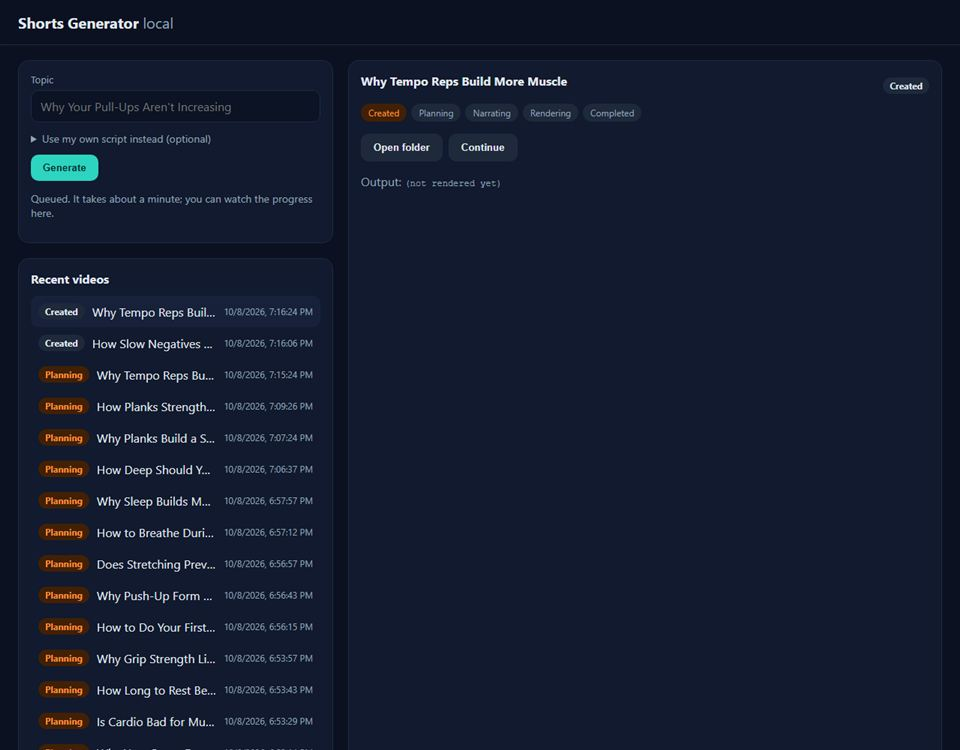
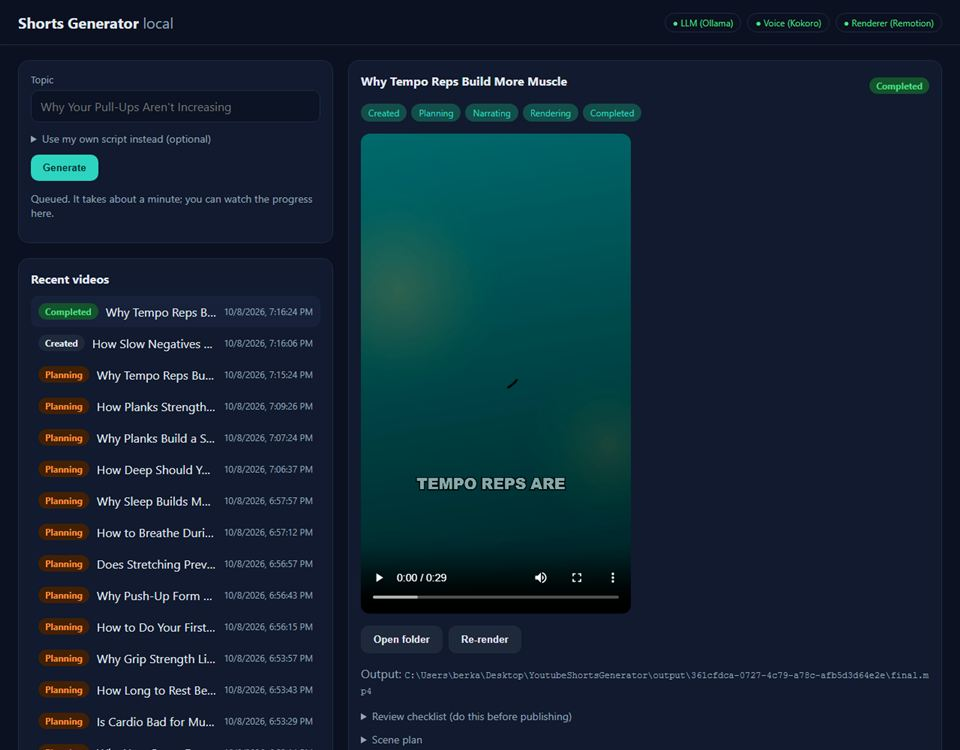
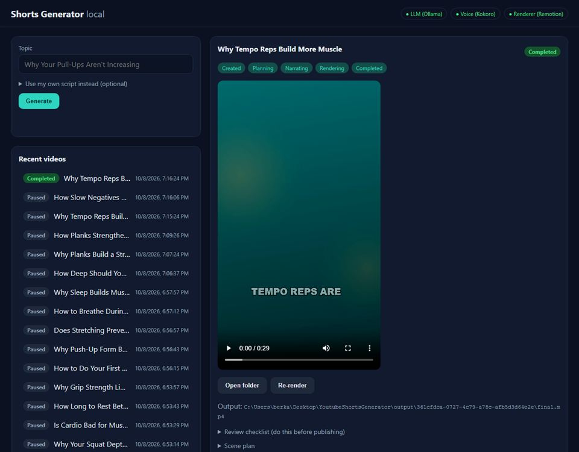

# Day 21 — Kod Notları

30 günlük roadmap, Gün 21. Konu: minimal yerel dashboard. Swagger ve terminal yerine tarayıcıda tek bir sayfa: konu ve opsiyonel script girişi, Generate butonu, son işler ve canlı durumları, sayfa içinde video oynatma, inceleme listesi, sahne planı, "klasörü aç" ve yerel servislerin sağlık durumu. Build zinciri yok: düz HTML/CSS/JS, aynı ASP.NET process'inden sunuluyor.

Bu doküman, bugün eklenen/değişen her kod parçasını **yazılma/kullanılma sırasına göre** gezer. Her parça için: kodun kendisi, **neden** böyle yazıldığı (mantık, çözdüğü gerçek problem) ve **nasıl** çalıştığı (syntax/teknik açıklama).

---

## 0. Sonuç

| Generate'den 1 sn sonra | 63 sn sonra | Liste (durum etiketleri) |
|---|---|---|
|  |  |  |

---

## 1. Neden build zinciri yok

`CLAUDE.md`: "en basit yararlı arayüz", "yerel kalsın", overengineering yok. React/Vite eklemek ikinci bir `npm install`, bir build adımı ve bir dev sunucusu demek. Bu sayfanın ihtiyacı birkaç form, bir liste ve periyodik `fetch` çağrıları: tarayıcının kendisi bunları zaten yapabiliyor. `web/` klasörü (`CLAUDE.md` §6'daki hedef yapı) düz `index.html` + `styles.css` + `app.js` içeriyor ve API ile **aynı origin**'den sunuluyor, bu yüzden CORS ayarı da gerekmiyor.

---

## 2. `Api/Endpoints/DashboardEndpoints.cs` — statik dosyalar

```csharp
public static WebApplication UseDashboard(this WebApplication app)
{
    var directory = Path.GetFullPath(app.Configuration["Dashboard:Directory"] ?? "../../web", app.Environment.ContentRootPath);
    if (!Directory.Exists(directory)) { app.Logger.LogWarning(...); return app; }
    var files = new PhysicalFileProvider(directory);
    app.UseDefaultFiles(new DefaultFilesOptions { FileProvider = files });   // "/" -> index.html
    app.UseStaticFiles(new StaticFileOptions { FileProvider = files });
    return app;
}
```

**Neden / Nasıl çalışıyor:**
* ASP.NET Core statik dosyaları varsayılan olarak `wwwroot/`'tan sunar. Biz repo kökündeki `web/` klasörünü bir `PhysicalFileProvider` ile gösteriyoruz. Yol, Day 11'deki kuralla content root'a göre çözülüyor.
* `UseDefaultFiles`, `/` isteğini `index.html`'e çeviriyor. `UseStaticFiles`'tan **önce** gelmek zorunda: biri isteği yeniden yazar, diğeri dosyayı sunar.
* Klasör yoksa uygulama çökmüyor, sadece uyarı veriyor: API arayüzsüz de çalışmaya devam ediyor.
* `Program.cs` büyüdüğü için dashboard'a özel kod ayrı bir dosyada, extension metotlarla (`UseDashboard()`, `MapDashboardEndpoints()`).

---

## 3. Video, inceleme ve "klasörü aç" endpoint'leri

```csharp
app.MapGet("/api/videos/{id:guid}/video", (Guid id, IJobOutputLocator locator) =>
    File.Exists(path) ? Results.File(path, "video/mp4", enableRangeProcessing: true) : Results.NotFound());

app.MapGet("/api/videos/{id:guid}/review", ...  Results.File(path, "text/markdown; charset=utf-8") ...);

app.MapPost("/api/videos/{id:guid}/open-folder", (Guid id, IJobOutputLocator locator, HttpContext context) =>
{
    if (!IsLocalRequest(context)) return Results.StatusCode(403);
    ...
    var startInfo = new ProcessStartInfo("explorer.exe") { UseShellExecute = false };
    startInfo.ArgumentList.Add(directory);
    Process.Start(startInfo)?.Dispose();
});
private static bool IsLocalRequest(HttpContext c) =>
    c.Connection.RemoteIpAddress is { } address && IPAddress.IsLoopback(address);
```

**Neden / Nasıl çalışıyor:**
* **Range desteği**: tarayıcının `<video>` elemanı videoyu baştan sona indirmez. Byte aralıkları ister (`Range: bytes=100-199`) ve sunucu `206 Partial Content` ile sadece o parçayı döner. İleri sarma ve "indirilmeden oynatmaya başlama" bununla çalışıyor. `enableRangeProcessing: true` bunu ASP.NET Core'a bırakıyor (test edildi: 100 baytlık aralık → `206`, 100 bayt).
* **Klasörü aç**: bu uygulama kullanıcının kendi makinesinde çalıştığı için "dosyamı göster" demek meşru bir istek. Yine de bir HTTP isteğiyle process başlatmak ciddi bir iş:
  * klasör, job'ın `Guid`'inden türetiliyor, istekteki metinden asla değil;
  * `explorer.exe` doğrudan, shell olmadan ve `ArgumentList` ile başlatılıyor (Day 11/13 kuralı);
  * istek **kanıtlanabilir şekilde** yerel olmalı (loopback IP). Bellek içi test sunucusunda istemci IP'si hiç yok. Kod bunu "kanıtlayamıyorum = hayır" olarak yorumlayıp `403` dönüyor. Bu da güvenli varsayılanın test edilmiş hali.

---

## 4. `web/app.js` — arayüz mantığı

```js
async function api(path, options = {}) { ... throw new Error(body.error ?? `HTTP ${status}`) ... }
async function refreshHealth()   // /api/llm/health, /api/tts/health, /api/renderer/health -> yeşil/kırmızı rozetler
form submit -> POST /api/videos {topic, sourceScript} -> "Queued..."
async function refreshJobs()     // GET /api/videos?take=30, her 2.5 sn (polling)
async function renderDetail(job) // aşamalar, hata, <video>, aksiyonlar, review.md, plan tablosu
```

**Neden / Nasıl çalışıyor:**
* **Polling**: arayüz her 2.5 saniyede listeyi yeniden istiyor. Day 14'teki `202 Accepted` + "durum adresini sorgula" sözleşmesinin istemci tarafı. Yerel tek kullanıcılı bir uygulama için WebSocket/SignalR gereksiz karmaşıklık olurdu.
* **XSS koruması**: konular, script'ler, planlar ve hata mesajları kullanıcının ya da yerel LLM'in yazdığı metinler. Sayfaya **sadece `textContent`** ile konuyor, asla `innerHTML` ile değil. Böylece metnin içinde `<script>` olsa bile tarayıcı onu kod değil düz metin olarak gösteriyor. (Day 20'de SVG'ler için yapılan güvenlik kapısıyla aynı düşünce: kontrol etmediğin içeriği koda dönüştürme.)
* **Gereksiz yeniden çizim yok**: detay paneli sadece işin durumu değiştiğinde yeniden kuruluyor (`job.id|status|isQueued|isRunning|updatedAt` anahtarı). Yoksa her polling'de video başa sarardı.
* **Önbellek kırma**: video adresi `?v=<updatedAt>` alıyor. Yeniden render edilen bir videoyu tarayıcı eski önbelleğinden göstermiyor.

---

## 5. Bulunan ve düzeltilen: "Planning"de görünen ama çalışmayan işler

İlk tam ekran görüntüsünde listedeki işlerin çoğu turuncu bir **"Planning"** rozetiyle görünüyordu. Gerçekte hiçbiri çalışmıyordu: bunlar Day 19–20'de sadece plan üretmek için elle açılan işlerdi, artı bugün test sırasında API kapatıldığı için yarıda kalan iki iş. Arayüz bunları "devam ediyor" gibi gösteriyordu.

```csharp
// VideoJobResponse
bool IsRunning,      // sadece worker bu işi ŞU AN işliyorsa true
public static VideoJobResponse FromDomain(VideoJob job, IVideoJobQueue? queue = null, Guid? runningJobId = null)
// endpoint'ler: VideoJobWorker worker -> worker.CurrentJobId   (Day 14'te bu amaçla singleton olarak kaydedilmişti)
```
```js
function statusLabel(job) {
  if (terminal || job.isRunning) return job.status;
  return job.isQueued ? "Queued" : "Paused";      // ara durumda ama kimse işlemiyor -> Paused
}
```

**Neden:** Bir arayüzün en önemli özelliği dürüst olması. Ara durumdaki (`Planning`, `Narrating`...) bir iş ancak worker'da ise (kuyrukta veya işleniyor) gerçekten ilerliyor. Değilse "Paused" yazılıyor ve detayda **Continue** düğmesi (Day 14'teki `/generate`, kaldığı yerden devam) çıkıyor. Day 14'te worker'ı singleton olarak kaydedip `CurrentJobId`'yi açık bırakmanın sebebi buydu. Yeniden başlatmada yarıda kalan işlerin otomatik ele alınması Day 26'nın işi. Bugün o işler için iki gerçek test vakası da oluştu.

---

## 6. Gerçek tarayıcıyla uçtan uca test: `renderer/scripts/dashboard-smoke.mjs`

```js
import { openBrowser } from "@remotion/renderer";       // Remotion'ın zaten getirdiği headless Chrome
const page = await browser.newPage({...});
await page.goto({ url: "http://localhost:5007" });
await page.evaluate((t) => { document.querySelector("#topic").value = t; document.querySelector("#generate").click(); }, topic);
await waitFor("Completed or Failed", () => ..., 300000);
const response = await page._client().send("Page.captureScreenshot", { format: "png" });   // CDP
```

**Neden:** Kabul kriteri "kullanıcı arayüzden bir iş başlatabilmeli". Bunu en dürüst doğrulama yolu, gerçek bir tarayıcıda butona gerçekten basmak. Playwright gibi yeni bir araç kurmak yerine Remotion'ın render için zaten indirdiği headless Chrome kullanıldı. Ekran görüntüsü Chrome DevTools Protocol'ün `Page.captureScreenshot` komutuyla alınıyor.

### Script'te bulunan iki hata
1. *"Timed out waiting for: the new job in the list"*: `page.evaluate(fn)` fonksiyonu **tarayıcının içinde** çalıştırıyor. Node tarafındaki bir değişkene (closure) oradan erişilemez, değer `undefined` gelir. Değer argüman olarak iletilmeli: `waitFor(..., predicate, timeout, topic)`.
2. *"Buffer.from ... Received undefined"*: Remotion'ın CDP oturumu protokol cevabını `{ value: { data } }` şeklinde sarmalıyor, `{ data }` olarak değil. İki biçim de okunuyor.

---

## Doğrulanan davranış

```
$ dotnet test   -> Domain 71, Application 97, Infrastructure 84, Api 11   (toplam 263; Day 20'de 259)
   yeni API testleri: "/" dashboard'u ve app.js'i sunuyor; video Range isteğine 206 + video/mp4 + 100 bayt;
   olmayan video/review 404; open-folder yerelliği kanıtlanamayan çağırana 403
```

Gerçek tarayıcı + gerçek pipeline (Ollama + Kokoro + Remotion):
```
$ node scripts/dashboard-smoke.mjs "Why Tempo Reps Build More Muscle" ../output/dashboard-smoke
after 1011 ms: "Queued. It takes about a minute; you can watch the progress here."
screenshot 1-queued.png
job finished after 63 s: Completed
video element: {"duration":29.355,"width":1080,"height":1920}
screenshot 2-completed.png
```

Bu çıktılar şunu kanıtlıyor: kullanıcı arayüzden bir iş başlatabiliyor (roadmap kabul kriteri). İş arka planda tamamlanıyor, video aynı sayfada oynatılabiliyor (tarayıcı 1080×1920, 29.4 sn olarak okudu). Sağlık rozetleri üç yerel servisin hazır olduğunu gösteriyor. Duraklamış işler dürüstçe "Paused" olarak etiketleniyor.
