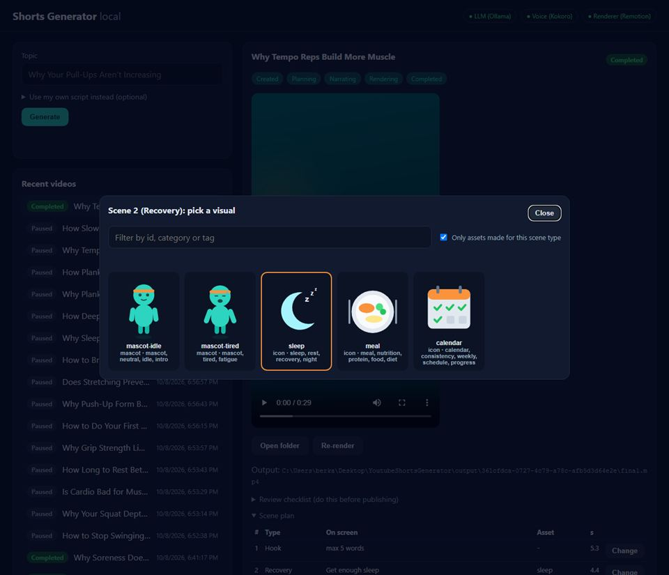
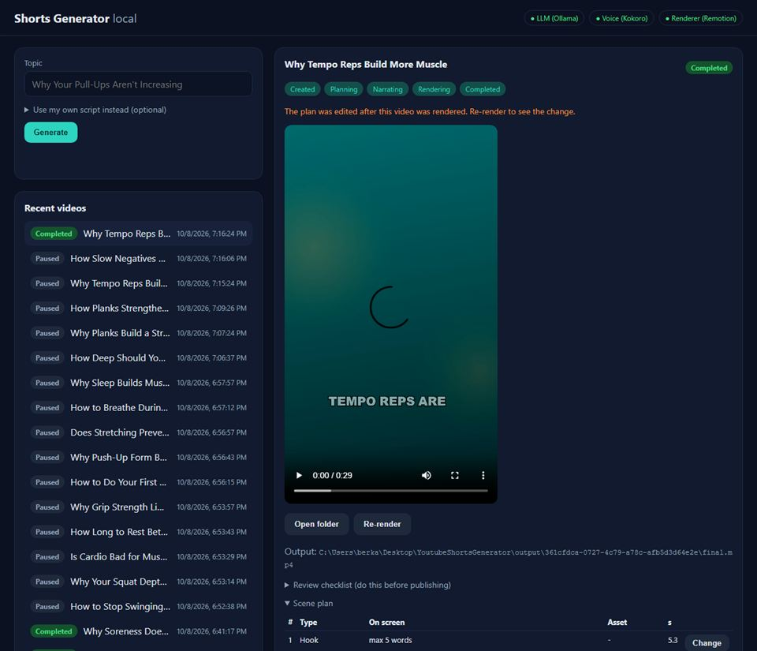
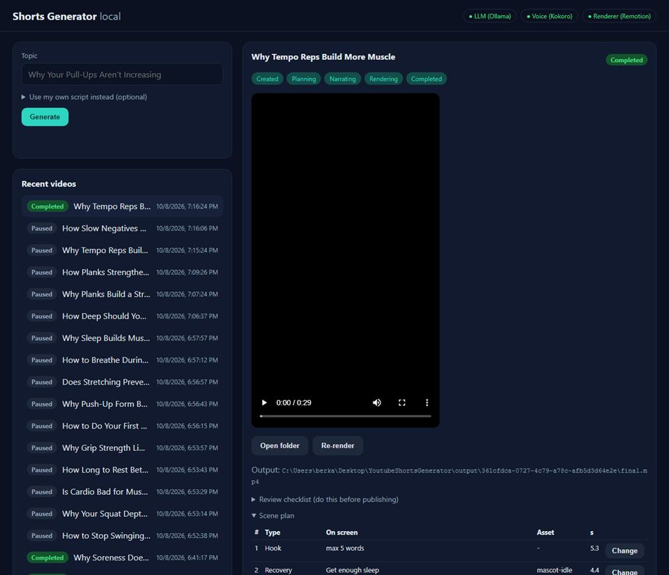

# Day 22 — Kod Notları

30 günlük roadmap, Gün 22. Konu: asset inceleme ve seçme arayüzü. Dashboard'da önizlemeli bir asset kataloğu, ve bir videonun sahne planında tek bir sahnenin görselini katalogdaki başka bir asset'le **güvenle** değiştirip yeniden render etme. Tam bir editör değil: sadece görsel değiştiriliyor, değişiklik doğrulanıyor, render sırasında düzenleme kilitli.

Bu doküman, bugün eklenen/değişen her kod parçasını **yazılma/kullanılma sırasına göre** gezer. Her parça için: kodun kendisi, **neden** böyle yazıldığı (mantık, çözdüğü gerçek problem) ve **nasıl** çalıştığı (syntax/teknik açıklama).

---

## 0. Sonuç (gerçek tarayıcıda)

| Seçici (sahne 2, Recovery) | Değişiklikten sonra: "güncel değil" uyarısı | Re-render sonrası |
|---|---|---|
|  |  |  |

---

## 1. `Application/PlanEditService.cs`

```csharp
public async Task<VideoPlan> ChangeSceneAssetAsync(Guid jobId, string sceneId, string assetId, CancellationToken ct)
{
    var (job, plan) = await LoadEditableAsync(jobId, ct);
    var scene = plan.Scenes.FirstOrDefault(s => s.Id == sceneId) ?? throw new KeyNotFoundException(...);
    var asset = await _assets.GetByIdAsync(assetId, ct) ?? throw new PlanEditException("... not an asset in the catalog.");
    var edited = plan with { Scenes = plan.Scenes.Select(s => s.Id == sceneId ? s with { AssetIds = [asset.Id] } : s).ToList() };
    return await SaveValidatedAsync(job, edited, ct);
}

private async Task<(VideoJob, VideoPlan)> LoadEditableAsync(Guid jobId, CancellationToken ct)
//   Rendering veya kuyrukta -> InvalidOperationException (409)
//   Failed                  -> InvalidOperationException
//   plan yok                -> InvalidOperationException

private async Task<VideoPlan> SaveValidatedAsync(VideoJob job, VideoPlan edited, CancellationToken ct)
{
    var validation = VideoPlanValidator.Validate(edited, edited.NarrationText, knownIds, checkDurations: false);
    if (!validation.IsValid) throw new PlanEditException(...);
    var warnings = PlanVariationRules.Check(edited);                  // inceleme uyarıları yeniden hesaplanıyor
    var saved = edited with { ReviewWarnings = warnings.Count == 0 ? null : warnings };
    await _planStore.SaveAsync(job.Id, saved, ct);                     // job'ın durumu DEĞİŞMİYOR
    return saved;
}
```

**Neden:**
* **Aynı kurallar**: elle yapılan bir değişiklik, üretilen bir planın geçmek zorunda olduğu doğrulayıcıdan (`VideoPlanValidator`, Day 5) tekrar geçiyor. Bir insan düzenlemesi, pipeline'ın kendisinin reddedeceği bir plan üretemiyor. Asset id'si katalogdan olmak zorunda: LLM için konan "sadece bilinen asset'ler" kuralının (Day 6/15) insan için de geçerli hali. `"../../evil"` gibi bir id daha katalog kontrolünde reddediliyor (test edildi).
* **Render sırasında kilit**: renderer `plan.json`'ı okuyor. Render ortasında gelen bir düzenleme ya yarısı eski yarısı yeni bir video üretir ya da sessizce kaybolur. Bu klasik bir **yarış durumu** (race condition). İş kuyruktaysa veya `Rendering` durumundaysa düzenleme `409` ile reddediliyor.
* **Durum değişmiyor**: `Completed` bir iş `Completed` kalıyor. Videosu sadece "güncel değil" oluyor (bölüm 3). Yeni bir durum (enum değeri) eklemek, Day 2'den beri test edilen durum makinesini karmaşıklaştırırdı. Dosya zaman damgaları zaten gereken bilgiyi taşıyor.
* **Uyarılar yeniden hesaplanıyor**: bir insan, iki ardışık sahneye aynı görseli koyarak Day 19'un çeşitlilik kuralını bozabilir. Bu engellenmiyor (karar insanın) ama `review.md` için uyarı olarak kaydediliyor.

---

## 2. `VideoPlanValidator.Validate(..., checkDurations)` (Day 5 dosyası, değişti)

```diff
-    public static ValidationResult Validate(VideoPlan plan, string expectedNarrationText, IReadOnlySet<string> knownAssetIds)
+    public static ValidationResult Validate(VideoPlan plan, string expectedNarrationText, IReadOnlySet<string> knownAssetIds,
+                                            bool checkDurations = true)
...
-        ValidateTotalDuration(plan, reasons);
+        if (checkDurations) ValidateTotalDuration(plan, reasons);
```

**Neden:** "Toplam 20–50 sn, sahne başına 1–12 sn" kuralları LLM'in **tahmin ettiği** süreler için bir akıl sağlığı kontrolüydü. Narration'dan sonra süreler gerçek sesten **ölçülüyor** (Day 12). Day 12'deki örnek videonun gerçek sesi 16.9 saniyeydi. Süre kontrolüyle o planda tek bir görseli değiştirmek bile "geçersiz plan" hatası verirdi. Varsayılan `true` olduğu için mevcut bütün çağrılar değişmeden aynı davranıyor (test edildi: 6 × 2.8 sn = 16.8 sn'lik bir plan düzenlenebiliyor).

---

## 3. API: değiştirme, önizleme, "güncel değil" (`DashboardEndpoints`, `VideoJobContracts`)

```csharp
app.MapPut("/api/videos/{id:guid}/scenes/{sceneId}/asset", (Guid id, string sceneId, ChangeSceneAssetRequest request, PlanEditService edits, ...) =>
    await EditAsync(() => edits.ChangeSceneAssetAsync(id, sceneId, request.AssetId, ct)));
// EditAsync: KeyNotFound -> 404, InvalidOperation -> 409, PlanEditException -> 422

app.MapGet("/api/assets/{id}/svg", ... =>
{
    context.Response.Headers.ContentSecurityPolicy = "default-src 'none'; style-src 'unsafe-inline'";
    context.Response.Headers.XContentTypeOptions = "nosniff";
    return Results.File(asset.FilePath, "image/svg+xml");
});

public static bool IsVideoOutdated(IJobOutputLocator locator, Guid jobId)
    => video.Exists && plan.Exists && plan.LastWriteTimeUtc > video.LastWriteTimeUtc;
// VideoJobResponse: bool VideoOutdated
```

**Neden / Nasıl çalışıyor:**
* **`PUT`**: "bu sahnenin görseli şu olsun" demek, bir kaynağın belirli bir alt öğesini bilinen bir değere ayarlamak. Tekrarlansa da aynı sonucu veriyor (idempotent), bu yüzden `POST` değil `PUT`.
* **SVG önizlemesi `` ile**: tarayıcı, `` olarak yüklenen bir SVG'nin içindeki script'leri **hiçbir zaman** çalıştırmaz (Day 20'de renderer'ın kullandığı satır içi gömmenin aksine). Biri dosyayı doğrudan sekmede açsa bile `Content-Security-Policy: default-src 'none'` script'i yine engelliyor. `nosniff`, tarayıcının içerik tipini "tahmin edip" başka bir şey gibi yorumlamasını önlüyor. Day 20'deki "katalogda script olamaz" kuralının üstüne iki savunma katmanı daha (defense in depth).
* **"Güncel değil"**: `plan.json`, `final.mp4`'ten daha yeniyse oynatıcıdaki video artık planın söylediğini göstermiyor. Dosya sisteminin zaten tuttuğu zaman damgalarından hesaplanıyor. Veritabanına yeni bir alan gerekmiyor.

---

## 4. Arayüz: seçici ve "Change" düğmeleri (`web/`)

```js
async function openAssetPicker(target)   // target = {job, scene}  veya  null (sadece göz atma)
  // filtre: "Only assets made for this scene type" (varsayılan açık) + id/kategori/etiket arama
  // her kart: /svg">, id, kategori · etiketler; mevcut olan turuncu çerçeveli
async function chooseAsset(target, assetId)  // PUT ... -> dialog.close() -> detayı yenile
```

**Nasıl çalışıyor:**
* Tarayıcının yerleşik `<dialog>` elemanı (`showModal()`): odak yönetimi, ESC ile kapanma ve arka plan karartması ücretsiz geliyor, bir modal kütüphanesi gerekmiyor.
* "Sadece bu sahne tipine uygun asset'ler" filtresi, manifest'teki `compatibleSceneTypes` alanını (Day 6) kullanıyor. Kapatılınca bütün katalog görünüyor: insan, kuralın dışına bilinçli olarak çıkabiliyor.
* Sahne tablosunda "Change" sadece iş işlenmiyorken görünüyor. API de aynı kuralı uyguluyor: arayüz kolaylık, güvence backend'de.
* Düzenlemeden sonra detay yeniden çiziliyor, ama açık olan "Scene plan" ve "Review" bölümleri **açık kalıyor**. Yoksa kullanıcı her düzenlemede yerini kaybederdi.
* Sol altta "Browse assets": katalogu salt okunur gezmek için (roadmap: "bilinen asset id'lerini/kategorilerini görüntüle").

---

## 5. Bulunan ve düzeltilen: kopyalanan prompt yer tutucuları

Dashboard'un plan tablosunda bir Hook sahnesinin ekran metni şuydu: **`max 5 words`**. Bu, prompt'taki JSON iskeletinin yer tutucu metni: model onu içerik sanmış. (Day 20'deki "örnek mit metnini kopyalama" sorununun kardeşi.)

```csharp
// ScenePlanPromptBuilder: yer tutucular tek bir yerde tanımlı, prompt bunlardan üretiliyor
public const string OnScreenTextPlaceholder = "max 5 words";   // + Title/Hook/Takeaway/Emphasis
public static bool IsPlaceholder(string? text) => Placeholders.Any(p => string.Equals(p, text.Trim(), OrdinalIgnoreCase));
sb.AppendLine("The values above describe what goes in each field - replace every one of them with real content.");

// ScenePlanningService: geri gelen yer tutucu = "eksik" (aynı yedekler devreye giriyor)
if (string.IsNullOrWhiteSpace(text) || ScenePlanPromptBuilder.IsPlaceholder(text)) return null;
static string? Real(string? text) => ... IsPlaceholder(text) ? null : text.Trim();
Title: Real(generated.Title) ?? "Untitled",  Hook: Real(generated.Hook) ?? segments[0],  Takeaway: Real(generated.Takeaway)
```

**Neden / Nasıl çalışıyor:** Prompt ile ayrıştırıcı aynı sabitleri kullandığı için ikisi birbirinden kopamıyor: prompt'taki metin değişirse kontrol de otomatik değişiyor. `$$"""..."""` C# 11'in ham interpolated string'i: `{{...}}` interpolasyon, tek `{` ise JSON'un kendi süslü parantezi (kaçış gerekmiyor). Yer tutucu bir takeaway `null` sayılıyor, böylece Day 19'un "takeaway boş" yumuşak kuralı tetikleniyor ve LLM'den gerçek bir ders isteniyor.

---

## 6. Gerçek tarayıcı testi: `renderer/scripts/dashboard-edit-smoke.mjs`

Day 21'deki headless Chrome yaklaşımıyla: tamamlanmış bir videoyu seç → planı aç → sahne 2'de "Change" → seçiciden mevcut olmayan uyumlu ilk asset'i seç → "güncel değil" uyarısını bekle → Re-render → uyarının kaybolmasını bekle.

```
screenshot 3-picker.png
scene 2 asset: sleep -> mascot-idle (picked mascot-idle); outdated notice shown
screenshot 4-outdated.png
re-rendered; outdated notice gone
screenshot 5-rerendered.png
```

---

## Doğrulanan davranış

```
$ dotnet test   -> Domain 71, Application 104, Infrastructure 84, Api 13   (toplam 272; Day 21'de 263)
```
Yeni testler: `PlanEditServiceTests` (6: değiştir + kaydet + durum aynı; ses zamanlı kısa plan düzenlenebilir; katalog dışı asset reddi; bilinmeyen sahne; kuyruktaki/render'daki iş kilidi; yeniden hesaplanan çeşitlilik uyarısı), placeholder testi (1), API (2: SVG `image/svg+xml` + CSP, bilinmeyen job'da `PUT` → 404).

Gerçek tarayıcı testi (bölüm 6): kullanıcı tek bir sahnenin asset'ini katalogdaki başka bir asset'le güvenle değiştirdi ve video yeniden render edildi (roadmap kabul kriteri).
