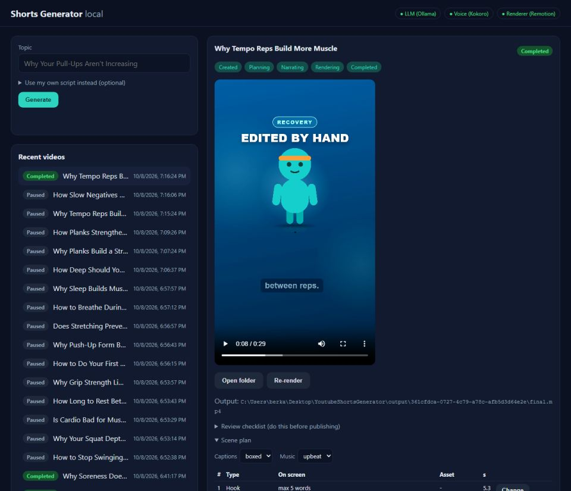
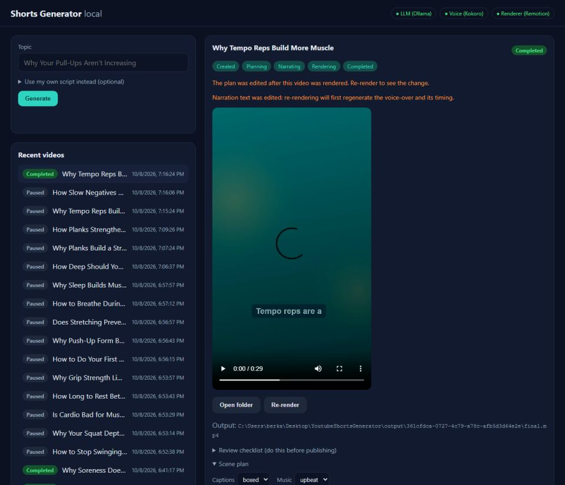
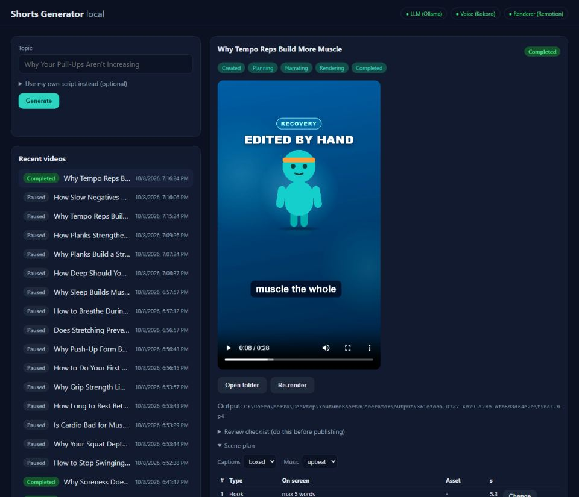

# Day 23 — Kod Notları

30 günlük roadmap, Gün 23. Konu: plan düzenleme ve yeniden render. Dashboard'dan bir sahnenin ekran metni, ikinci metni, maddeleri, animasyonu, ses efekti, vurgu kelimesi, tipi ve **anlatım metni** düzenlenebiliyor. Altyazı stili ve müzik de değiştirilebiliyor. Tek bir "Re-render" düğmesi neyin değiştiğine bakıp ya sadece render ediyor ya da önce sesi yeniden üretiyor.

Bu doküman, bugün eklenen/değişen her kod parçasını **yazılma/kullanılma sırasına göre** gezer. Her parça için: kodun kendisi, **neden** böyle yazıldığı ve **nasıl** çalıştığı.

---

## 0. Sonuç (gerçek tarayıcıda)

| Görsel düzenleme + boxed altyazı, render sonrası | Anlatım düzenlendi: "ses yeniden üretilecek" uyarısı | Yeni ses + yeni zamanlama ile render |
|---|---|---|
|  |  |  |

---

## 1. `Application/PlanEditService.cs`: `SceneEdit` ve "patch" anlamı

```csharp
public sealed record SceneEdit(
    string? OnScreenText = null, string? SecondaryText = null, IReadOnlyList<string>? Items = null,
    AnimationId? Animation = null, SfxId? Sfx = null, bool ClearSfx = false,
    string? Emphasis = null, SceneType? Type = null, string? Narration = null);

// null = keep; "" (after trimming) = clear.
private static string? Optional(string? edit, string? current) =>
    edit is null ? current : string.IsNullOrWhiteSpace(edit) ? null : edit.Trim();
```

**Neden:** Bu bir **kısmi güncelleme** (partial update / PATCH semantiği). İstemci sadece değiştirmek istediği alanı gönderiyor. Her alanın üç durumu var: "gönderilmedi" (dokunma), "boş" (temizle) ve "değer" (ayarla). C#'ta `null` ile `""` farklı olduğundan iki ayrı anlam taşıyabiliyorlar. `Sfx` bir enum: enum'un "boş string" hali olmadığı için temizleme ayrı bir bayrakla (`ClearSfx`) ifade ediliyor.

**Nasıl çalışıyor:** `scene with { ... }` kaydın kopyasını üretiyor (record'lar değiştirilemez). Her alan `Optional(...)` veya `??` ile ya eski değeri koruyor ya da yenisini alıyor. Maddeler kırpılıyor, boşlar atılıyor ve en fazla 3 tane kalıyor (Day 18 kuralı).

---

## 2. Yapı koruması: Hook ilk, Outro son

```csharp
if (edit.Type is { } newType && newType != scene.Type &&
    (scene.Type is SceneType.Hook or SceneType.Outro || newType is SceneType.Hook or SceneType.Outro))
    throw new PlanEditException("The first scene stays Hook and the last stays Outro; other scenes can't become either.");
```

**Neden:** Day 15'ten beri planın iskeleti kodda zorlanıyor: ilk sahne Hook, son sahne sessiz Outro. Bu iki sahnenin tipi değişirse veya ortadaki bir sahne Hook'a dönüşürse validator planı zaten reddederdi, ama kullanıcı "plan geçersiz" gibi belirsiz bir hata görürdü. Burada kural adıyla ve anlaşılır bir mesajla söyleniyor. `is { } newType`, "null değilse değerini `newType`'a al" anlamına gelen bir property pattern.

---

## 3. Anlatım metni değişince: güvenlik kontrolü ve `NarrationOutdated`

```csharp
if (narrationChanged)
{
    var narrationText = string.Join(' ', scenes.OrderBy(s => s.Order).Select(s => s.Narration)...);
    var safety = ScriptValidator.Validate(narrationText);
    var unsafeReasons = safety.Reasons.Where(r => r.Contains("disallowed", ...)).ToList();
    if (unsafeReasons.Count > 0) throw new PlanEditException(string.Join("; ", unsafeReasons));
    edited = edited with { NarrationText = narrationText, NarrationOutdated = true };
}
```

```diff
 // Domain/VideoPlan.cs
     IReadOnlyList<string>? ReviewWarnings = null,
+    bool NarrationOutdated = false);
```

**Neden:**
* `VideoPlan.NarrationText`, tanım gereği sahne anlatımlarının birleşimi. `VideoPlanValidator` (Day 5) bunu kontrol ediyor, o yüzden metin yeniden kuruluyor.
* İnsanın yazdığı kelimeler de LLM'in yazdıklarıyla aynı **sağlık iddiası filtresinden** geçiyor ("cure", "guaranteed" vb., Day 4). Sadece "disallowed" nedenleri alınıyor. Kelime sayısı kuralı (65–140) burada uygulanmıyor: tek bir sahnenin cümlesini kısaltmak bütün videoyu engellememeli.
* **`NarrationOutdated`**: metin değişti ama `narration.wav` ve her sahnenin süresi hâlâ **eski** kelimelere ait. Bu bilgi plan dosyasında tutuluyor, böylece API yeniden başlasa bile kaybolmuyor. Bir sonraki adım (bölüm 5–6) bu bayrağa bakıyor.

---

## 4. `UpdateSettingsAsync`: altyazı stili ve müzik

```csharp
// Domain/CaptionStyleId.cs (yeni)
public static class CaptionStyleId
{
    public const string Bold = "bold";
    public const string Boxed = "boxed";
    public static IReadOnlyList<string> All { get; } = [Bold, Boxed];
    public static bool IsKnown(string? id) => id is not null && All.Contains(id, StringComparer.OrdinalIgnoreCase);
}
```

**Neden:** Renderer'daki `CAPTION_STYLES` (Day 10) sadece `bold` ve `boxed`'ı tanıyor. Backend de aynı beyaz listeyi kullanıyor, böylece bilinmeyen bir stil plana hiç girmiyor. Bu, LLM için konan "sadece izin verilen değerler" kuralının insan için de geçerli hali. Müzik `MusicMood.Normalize` (Day 17) ile aynı şekilde kontrol ediliyor.

---

## 5. Ses tarafı: `MarkNarrating` artık `Completed`'dan da çağrılabilir; `NarrationService`

```diff
 // Domain/VideoJob.cs
 public void MarkNarrating(DateTimeOffset now)
 {
-    EnsureStatus(VideoJobStatus.Planning);
+    // Completed: a narration text edit (Day 23) regenerates the voice-over of a finished video.
+    EnsureStatusIn(VideoJobStatus.Planning, VideoJobStatus.Completed);
```

```diff
 // Application/NarrationService.cs
-var timedPlan = SceneTimingCalculator.Apply(plan, audio.Segments, audio.DurationSeconds, VideoFormat.Fps);
+var timedPlan = SceneTimingCalculator.Apply(plan, audio.Segments, audio.DurationSeconds, VideoFormat.Fps)
+    with { NarrationOutdated = false };
```

**Neden:** Day 2'nin durum makinesi `Completed → Narrating` geçişini bilmiyordu, çünkü bitmiş bir videonun sesi o zamana kadar hiç yeniden üretilmiyordu. Bu geçiş bilinçli olarak açıldı ve test edildi (`MarkNarrating_FromCompleted_AllowsRegeneratingTheVoiceOver`). Diğer yasak geçişler (ör. `Created → Narrating`) hâlâ yasak. Yeni ses üretilip zamanlama uygulandığında bayrak iniyor: plan artık sesiyle tutarlı.

---

## 6. Güvenlik ağı: `RenderService` eski sesle render etmeyi reddediyor

```csharp
if (_planStore is not null && (await _planStore.LoadAsync(jobId, ct))?.NarrationOutdated == true)
    throw new InvalidOperationException($"Video job '{jobId}' has edited narration text; regenerate the narration before rendering.");
```

**Neden:** Eski `/render` endpoint'i hâlâ var (Day 14). Biri doğrudan onu çağırırsa altyazılar yeni metni gösterir, ses ise eski metni okur. Bu, fark edilmesi zor ve yayına çıkabilecek bir hata. Kural kullanıcı arayüzünde değil, **render'ın kendisinde** uygulanıyor: hangi yoldan gelinirse gelinsin geçerli.

---

## 7. Kuyruk: yeni iş tipi `Renarrate`

```csharp
public enum VideoJobWorkKind { Generate, Render, Renarrate }   // Renarrate: Day 23

// VideoGenerationPipeline.ProcessAsync
if (item.Kind == VideoJobWorkKind.Renarrate)
{
    await RunStageAsync(Stage.Narration, item.JobId, ct);
    await RunStageAsync(Stage.Render, item.JobId, ct);
    return;
}
```

**Neden:** Normal `Generate` akışı "kaldığın yerden devam et" mantığıyla çalışıyor (Day 14). `Completed` bir iş için ise yapacak bir şey yok. Sesi yeniden üretmek ayrı ve açık bir niyet, bu yüzden ayrı bir iş tipi oldu. İki aşama aynı worker'da sırayla çalışıyor; tek seferde tek render kuralı (Day 14) korunuyor.

---

## 8. API: `PUT .../scenes/{sceneId}`, `PUT .../settings`, `POST .../apply-edits`

```csharp
public sealed record SceneEditRequest(string? OnScreenText = null, ..., string? Animation = null, string? Sfx = null, string? Type = null, string? Narration = null)
{
    public SceneEdit ToDomain() => new(
        OnScreenText, SecondaryText, Items,
        Parse<AnimationId>(Animation, "animation"),
        string.IsNullOrWhiteSpace(Sfx) ? null : Parse<SfxId>(Sfx, "sfx"),
        ClearSfx: Sfx is not null && string.IsNullOrWhiteSpace(Sfx), ...);
    // Parse: Enum.TryParse + Enum.IsDefined, yoksa PlanEditException("allowed: Fade, Slide, ...")
}

app.MapPost("/api/videos/{id:guid}/apply-edits", async (...) =>
{
    if (job.Status is not (Narrating or Completed) || queue.IsQueued(id)) return Results.Conflict(...);
    var kind = plan?.NarrationOutdated == true ? VideoJobWorkKind.Renarrate : VideoJobWorkKind.Render;
    return queue.TryEnqueue(new VideoJobWorkItem(id, kind)) ? Results.Accepted(...) : Results.Conflict(...);
});
```

**Neden / Nasıl çalışıyor:**
* **DTO ↔ domain ayrımı**: HTTP'den gelen değerler string. Enum'a çevirme işi sınırda (API katmanında) yapılıyor, domain'e sadece geçerli tipler giriyor. `Enum.IsDefined` şart: `Enum.TryParse("99")` başarılı olur ve tanımsız bir değer üretir.
* Hata mesajı **izin verilen değerleri listeliyor** (`422` + "allowed: Fade, Slide, Pop, PunchZoom..."). Kullanıcı neyi yanlış yaptığını ve neyin doğru olduğunu aynı anda görüyor (CLAUDE.md §16).
* **`apply-edits`**: kullanıcı "sesi yeniden üretmem gerekiyor mu?" diye düşünmek zorunda değil. Plan bunu zaten biliyor (`NarrationOutdated`). Arayüzdeki "Re-render" düğmesi artık bu endpoint'i çağırıyor.

---

## 9. Arayüz: sahne düzenleyici (`web/index.html`, `web/app.js`)

```html
<dialog id="scene-editor">
  <form method="dialog" data-field="editor-form">
    Type / Animation / Sound effect (select) · Emphasis · On-screen text · Second text · Items (satır başına bir) · Narration
  </form>
</dialog>
<p class="notice" data-field="narration-outdated" hidden>Narration text was edited: re-rendering will first regenerate the voice-over and its timing.</p>
<select data-field="caption-style">bold | boxed</select>  <select data-field="music-mood">upbeat | calm</select>
```

**Nasıl çalışıyor:**
* Seçim kutularının seçenekleri sabit listelerden geliyor. Hook/Outro sahnesinde tip kutusu kilitli, diğer sahnelerde Hook/Outro seçenek olarak hiç sunulmuyor (backend kuralının arayüzdeki yansıması; güvence yine backend'de).
* Sadece **değişen** alanlar gönderiliyor (bölüm 1'deki patch anlamı). Hatalar (`422` mesajı) dialog içinde gösteriliyor ve dialog açık kalıyor.
* Bütün metinler hâlâ `textContent` ile yazılıyor (Day 21 kuralı, `innerHTML` yok).

---

## 10. Bulunan ve düzeltilen: `CS0160` (tekrarlanan `catch`)

```
error CS0160: A previous catch clause already catches all exceptions of this or of a super type ('InvalidOperationException')
```

**Neden:** `EditAsync`'e `PlanEditException` için bir `catch` eklerken, aynı `InvalidOperationException` bloğu yanlışlıkla iki kez kaldı. C# derleyicisi, ulaşılamayan bir `catch`'i hata olarak sayıyor.

**Nasıl çalışıyor (düzeltme):** Fazla blok silindi. Sıralama önemli: en özel tip (`PlanEditException` → 422) önce, ardından `KeyNotFoundException` (404), en son `InvalidOperationException` (409) yakalanıyor. (Düzeltmeyi bir script ile yapmak CRLF satır sonları yüzünden eşleşmedi, Edit aracıyla yapıldı.)

---

## 11. Gerçek tarayıcı testi: `renderer/scripts/dashboard-plan-edit-smoke.mjs`

Tamamlanmış bir videoda:
1. sahne 2'nin ekran metnini ve animasyonunu düzenle, altyazıyı `boxed` yap, Re-render → **sadece render**;
2. sahne 2'nin anlatımını düzenle, uyarıyı gör, Re-render → **önce ses, sonra render**.

```
scene 2 on screen after edit: "Edited by hand"; captions = boxed
screenshot 6-visual-edit-rendered.png
narration notice shown
screenshot 7-narration-edited.png
re-narrated + re-rendered; narration notice hidden = true
screenshot 8-narration-rendered.png
narration.wav: 10/08/2026 19:16:59 -> 10/08/2026 19:33:51
```
API logu:
```
Job 361cfdca-...: running stage Render / Rendered job ...                         <- 1) sadece render
Job 361cfdca-...: running stage Narration / Kokoro synthesized 28.72s of audio (6 segments)
Job 361cfdca-...: running stage Render / Rendered job ...                         <- 2) ses + render
```

---

## Doğrulanan davranış

```
$ dotnet test   -> Domain 72, Application 112, Infrastructure 84, Api 15   (toplam 283; Day 22'de 272)
```
Yeni testler:
* `PlanEditServiceTests` (+6): görsel alanlar (null = koru, "" = temizle); anlatım değişikliği `NarrationText`'i yeniden kurar ve `NarrationOutdated` koyar; güvensiz anlatım reddi; Hook/Outro yeniden tiplenemez ve oluşturulamaz; normal bir sahnenin anlatımını boşaltmak validasyonda reddedilir; sadece bilinen altyazı stili/müzik.
* `RenderServiceTests` (+1): `NarrationOutdated` plan render edilmiyor.
* `VideoGenerationPipelineTests` (+1): `Renarrate` = Narration sonra Render.
* `VideoJobTests` (+1): `Completed → Narrating`.
* API (+2): bilinmeyen job'da düzenleme/apply-edits → 404; bilinmeyen animasyon adı → 422 + izin verilen değerler.

Tarayıcı testi iki yolu da kanıtlıyor. Görsel bir düzenleme sesi değiştirmeden yeniden render ediyor: `narration.wav`'ın zaman damgası aynı kaldı, ilk log satırında Narration aşaması yok. Anlatım düzenlemesinde ise yeni bir ses üretildi (zaman damgası 19:33), sahneler yeni sese göre yeniden zamanlandı (video 0:29 → 0:28) ve uyarı kayboldu. Roadmap kabul kriteri karşılandı: kullanıcı küçük bir plan değişikliği yapıp tam pipeline'ı baştan çalıştırmadan yeniden render edebiliyor.

Not: ekran görüntüsünde sahne 1'in metni "max 5 words". Bu plan Day 22'deki yer tutucu düzeltmesinden **önce** üretilmişti. Yeni planlarda bu sorun yok, eskisi artık bu editörle düzeltilebiliyor.
