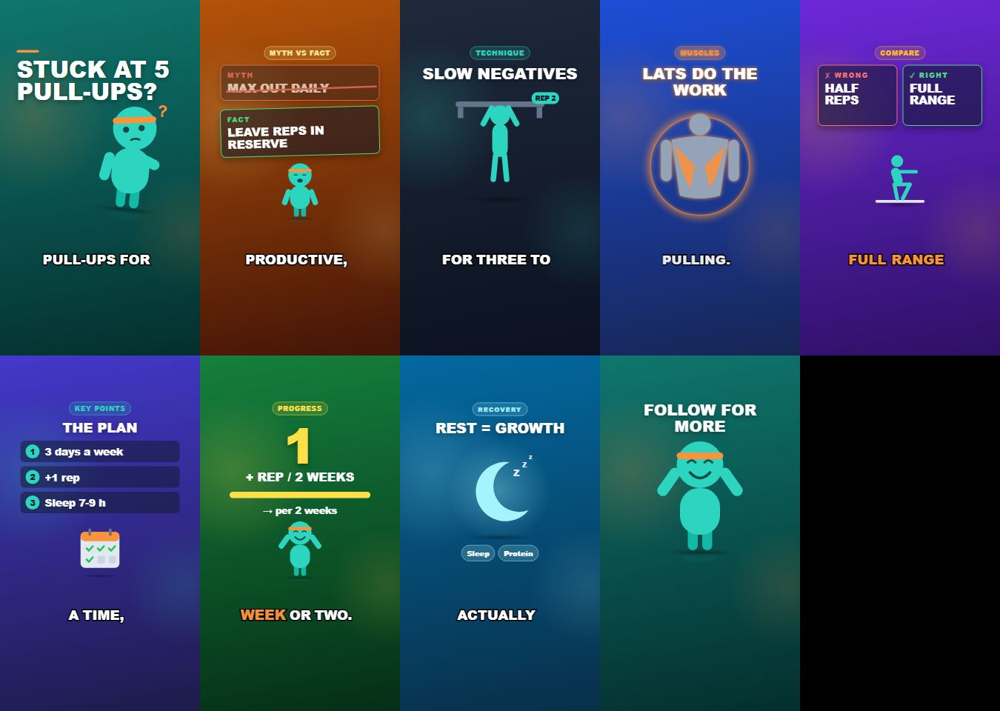

# Day 25 — Kod Notları

30 günlük roadmap, Gün 25. Konu: renderer ve şema testleri. Hedef: render girdisinin sözleşmesi sessizce bozulmasın. Bozuk bir girdi Chrome'un derinliklerinde değil, **erken** ve hangi alan olduğunu söyleyen bir mesajla reddedilsin.

Bu doküman, bugün eklenen/değişen her kod parçasını **yazılma/kullanılma sırasına göre** gezer.

---

## 0. Sonuç: smoke render, her sahne tipinden bir kare



---

## 1. Alanlar arası kurallar (`renderer/src/schemas/videoPlan.ts`)

```ts
export const VideoPlanSchema = z.object({ ...aynı alanlar... })
  .superRefine((plan, ctx) => {
    plan.scenes.forEach((scene, index) => {
      if (seenIds.has(scene.id))                                       -> scenes[i].id: duplicate scene id 's2'
      if (seenOrders.has(scene.order) || scene.order > plan.scenes.length) -> scenes[i].order: orders must be exactly 1..n
      if (Math.round(scene.durationSeconds * PLAN_FPS) < 1)            -> scenes[i].durationSeconds: shorter than one frame
      if (spoken > duration + 1/PLAN_FPS)                              -> scenes[i].spokenDurationSeconds: speech longer than the scene
    });
  });
```

**Neden:** Day 9'un şeması her alanı **tek başına** kontrol ediyordu. Bu dört hatanın her birinde alanlar tek tek geçerli; sorun alanların **birlikte** oluşturduğu durumda:
* **Tekrarlanan id**: React `key` olarak kullanılıyor (iki sahne karışabilir), ayrıca Day 22–23'ün düzenleme API'si sahneyi id ile buluyor.
* **`order` 1..n değil** (tekrar veya boşluk): hangi sahnenin önce oynayacağı belirsizleşir.
* **0 kareye yuvarlanan süre**: `<Series.Sequence durationInFrames={0}>` Remotion'ın içinde, hangi sahne olduğunu söylemeden patlıyor.
* **Konuşma süresi sahneden uzun**: altyazılar konuşulan süreye yayılıyor (Day 12), sahne bitince geri kalan kelimeler hiç görünmez.

**Nasıl çalışıyor:** `superRefine`, nesne alan alan doğrulandıktan sonra bütün nesneye bakan bir fonksiyon. `ctx.addIssue({ path: ["scenes", 3, "id"] })` hatayı tam o alana bağlıyor, böylece Day 13'teki `formatPath` mesajı `scenes[3].id` olarak yazıyor. Konuşma süresi için 1 karelik (1/30 sn) tolerans var: iki süre aynı sesten geliyor ama kareye ayrı ayrı yuvarlanıyor. `order` için "tekrar yok ve hiçbiri n'den büyük değil" kontrolü yeterli: n tane farklı pozitif tamsayı ≤ n, ancak tam olarak 1..n olabilir.

Gerçek veri kontrolü: `output/` altındaki **21 gerçek plan** geçici bir testle yeni şemadan geçirildi, 0 hata. Yeni kurallar daha önce üretilmiş hiçbir videoyu bozmuyor.

---

## 2. Tek bir zaman çizelgesi fonksiyonu (`renderer/src/scenes/timing.ts`)

```ts
export function orderedSceneFrames<T extends Timed>(scenes: readonly T[], fps: number): SceneFrames<T>[] {
  const ordered = [...scenes].sort((a, b) => a.order - b.order);
  let fromFrame = 0;
  return ordered.map((scene) => {
    const entry = { scene, fromFrame, durationInFrames: secondsToFrames(scene.durationSeconds, fps) };
    fromFrame += entry.durationInFrames;
    return entry;
  });
}
```

```diff
 // ShortComposition.calculateMetadata
-const durationInFrames = plan.scenes.reduce((total, scene) => total + secondsToFrames(scene.durationSeconds, FPS), 0);
+const timeline = orderedSceneFrames(plan.scenes, PLAN_FPS);
+const durationInFrames = last.fromFrame + last.durationInFrames;

 // SceneRenderer
-const orderedScenes = [...scenes].sort((a, b) => a.order - b.order);
-  const durationInFrames = secondsToFrames(scene.durationSeconds, fps);
+const timeline = orderedSceneFrames(scenes, fps);
+{timeline.map(({ scene, durationInFrames }, index) => ...
```

**Neden:** Videonun toplam uzunluğu (`calculateMetadata`) ile sahne sınırları (`<Series>`) iki ayrı yerde, iki ayrı döngüyle hesaplanıyordu. Bugün aynı sonucu veriyorlar, ama biri değişip diğeri değişmezse video son sahnenin ortasında kesilir ya da sonunda boş kareler kalır. Artık ikisi de aynı fonksiyondan geliyor (tek doğruluk kaynağı). Testler üç şeyi kontrol ediyor: sıranın `order`'a göre olduğunu (dizi sırasına göre değil), sahneler arasında boşluk veya çakışma olmadığını, ve toplamın backend'in kareye hizalanmış saniyeleriyle aynı olduğunu.

**Nasıl çalışıyor:** `<T extends Timed>` bir generic kısıt: fonksiyon `order` ve `durationSeconds` alanı olan her şeyle çalışıyor ve aldığı tipi aynen geri veriyor. Böylece `entry.scene` hâlâ tam bir `Scene` tipinde.

Kendi hatam: ilk testte `secondsToFrames(2.3833, 30)` için 72 bekledim; doğrusu 71.499 → **71**. Test düzeltildi ve iki taraf da (71 ve 72) artık açıkça test ediliyor.

---

## 3. .NET ↔ TypeScript sözleşme testi (`PlanContractTests.cs` + `samples/contract-plan.json`)

```csharp
[Fact]
public async Task ContractFixture_IsExactlyWhatTheBackendWrites()
{
    var directory = await store.SaveAsync(Guid.NewGuid(), CanonicalPlan(), ...);   // gerçek FileVideoPlanStore
    var written = Normalize(File.ReadAllText(directory/plan.json));
    if (UPDATE_CONTRACT == "1" || !File.Exists(fixturePath)) File.WriteAllText(fixturePath, written);
    Assert.Equal(Normalize(File.ReadAllText(fixturePath)), written);
}
[Fact] public void CanonicalPlan_PassesTheBackendsOwnValidation()   // + her SceneType en az bir kez
```

```ts
// renderer/src/schemas/videoPlan.test.ts
it("accepts the exact JSON the backend produces (contract fixture)", () => {
  const plan = parseVideoPlan(readJson("../../../samples/contract-plan.json"), "contract");
  // secondaryText, items, spokenDurationSeconds, sfx, "punchZoom" gerçekten okunuyor
});
```

**Neden:** Plan iki dil arasında taşınıyor: C# yazıyor, TypeScript (Zod) okuyor. Biri bir alanın adını ya da tipini değiştirirse (`AnimationId`'nin JSON yazımı gibi, Day 9'da tam olarak bu oldu) derleyiciler bunu göremez, çünkü ikisi ayrı projeler. Hata ancak bir sonraki render'da ortaya çıkar. Fixture iki testi birbirine bağlıyor:
* C# tarafı: "fixture, backend'in **bugün** yazdığıyla birebir aynı." Değişiklik varsa farkı gösteriyor.
* TS tarafı: "renderer bu dosyayı kabul ediyor ve alanları doğru anlıyor."

Kanıt (gerçek çıktı): Progress sahnesinin metni değiştirildiğinde C# testi farkı gösterdi.
```
ContractFixture_IsExactlyWhatTheBackendWrites [FAIL]
Expected: ···"  "secondaryText": "per 2 weeks",\n      ""···
Actual:   ···"  "secondaryText": "a typical pace",\n    "···
```
`UPDATE_CONTRACT=1 dotnet test` fixture'ı yeniden yazdı, ardından renderer testleri yeni dosyayı kabul etti. Kasıtlı bir değişiklikte akış bu: fixture'ı yenile, sonra renderer'ın hâlâ okuyabildiğini gör.

**Nasıl çalışıyor:**
* `CanonicalPlan()`, 9 sahne tipinin hepsini, bütün isteğe bağlı alanları ve gerçek katalog asset id'lerini kullanıyor; süreler 1/30 sn'nin katları (NarrationService'in ürettiği gibi). Aynı dosya smoke render'da da kullanılıyor (bölüm 4).
* `Normalize`, CRLF/LF farkını siliyor (Windows'ta git ayarı satır sonlarını değiştirebiliyor).
* Repo kökü, test DLL'inin klasöründen yukarı doğru `ShortsGenerator.slnx` aranarak bulunuyor; bu yüzden test hangi klasörden çalıştırılırsa çalıştırılsın çalışıyor.
* Bu, "consumer-driven contract testing" fikrinin küçük, yerel hali: Pact gibi bir araç ya da broker gerekmiyor.

---

## 4. Smoke render (`renderer/scripts/smoke-render.mjs`, `npm run smoke`)

```js
const serveUrl = await bundle({ entryPoint: "src/index.ts" });               // bir kez
const composition = await selectComposition({ serveUrl, id: "ShortComposition", inputProps });
check(1080x1920 @ 30 fps); check(durationInFrames === sum of scenes);
for (const scene of ordered) await renderStill({ frame: sahnenin %60'ı, scale: 0.25 });   // 9 still, hepsi farklı (sha1)
await renderMedia({ codec: "h264", scale: 0.25 }); getVideoMetadata(...)                   // tam video
await selectComposition({ planPath: "jobs/smoke-invalid/plan.json" })   // id'si tekrarlanan plan -> reddedilmeli
```

**Neden:** Vitest saf fonksiyonları test ediyor. Gerçek kompozisyon ise headless Chrome'da React + Remotion ile çalışıyor (`staticFile`, `fetch`, SVG'lerin satır içine gömülmesi, ses). "Her sahne tipi gerçekten çizilebiliyor mu?" ve "bozuk plan **Chrome içinde de** anlaşılır mesajla reddediliyor mu?" sorularının tek dürüst cevabı gerçek bir render. Düşük ölçek (0.25) ve tek bundle sayesinde bütün kontrol yaklaşık 23 saniye sürüyor.

**Nasıl çalışıyor:**
* Her still'in SHA-1 özeti alınıyor. İki sahne aynı kareyi üretirse (ör. şablon boş kaldı ve sadece arka plan çizildi) kontrol başarısız oluyor.
* Bozuk plan bundle'dan **önce** `public/jobs/` altına yazılıyor, çünkü bundle `public/` klasörünü oluşturulduğu anda kopyalıyor. İlk sürüm bozuk planı sonradan yazıp ikinci bir bundle alıyordu (~20 sn); sıra değiştirilince tek bundle yetti.
* Ölçüm notu (Day 27 için): ilk bundle 19.7 sn, webpack önbelleğiyle ikincisi 1.4 sn.

---

## Doğrulanan davranış

```
$ npm test (renderer)        Test Files 8 passed (8)   Tests 55 passed (55)     (Day 24: 40)
$ npm run lint               eslint + tsc: temiz
$ dotnet test                Domain 108, Application 114, Infrastructure 98, Api 24   (toplam 344; +2 sözleşme)
$ npm run smoke
bundled in 1.4s
ok   1080x1920 @ 30 fps
ok   duration 918 frames = sum of scenes (918)
ok   scene 1 Hook renders (frame 61) and differs from the others
ok   scene 2 MythVsFact renders (frame 177) and differs from the others
...  (9 sahne tipinin hepsi)
ok   scene 9 Outro renders (frame 894) and differs from the others
ok   full render 30.61s in 11.1s
     -> Error: Invalid plan JSON (jobs/smoke-invalid/plan.json): scenes[3].id: duplicate scene id 's2'
ok   invalid plan is refused before rendering, naming scenes[3].id
SMOKE OK
```

Bu çıktı şunu kanıtlıyor: backend'in ürettiği JSON renderer tarafından kabul ediliyor (sözleşme), 9 şablonun hepsi gerçek Chrome'da çiziliyor, videonun uzunluğu sahnelerin toplamına kare kare eşit, ve bozuk bir girdi render başlamadan, alan adıyla reddediliyor. Roadmap kabul kriteri ("invalid render input fails early and clearly") karşılandı.
