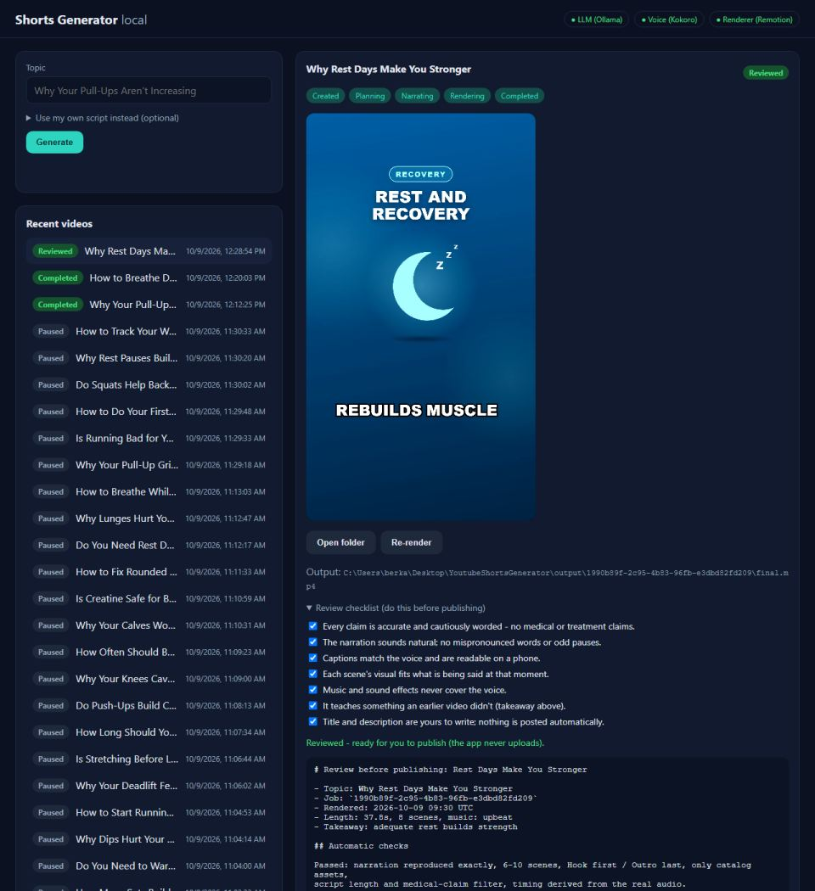

# Day 28 — Kod Notları

30 günlük roadmap, Gün 28. Konu: tek tıkla çalışma akışı. Bilgisayar açıldıktan sonra videoya kadar en az komut: `start.cmd` önkoşulları kontrol edip API'yi başlatıyor ve dashboard'u açıyor; `generate.cmd "konu"` tek komutla video üretiyor. İnsan inceleme adımı artık kayıtlı bir onay (yükleme yok), ve `output/INDEX.md` GUID klasörlerini okunur bir listeye çeviriyor.

Bu doküman, bugün eklenen/değişen her kod parçasını **yazılma/kullanılma sırasına göre** gezer.

---

## 0. Sonuç (gerçek tarayıcı)



Video oynarken 7 madde işaretlendi: rozet "Reviewed" oldu ve video baştan başlamadı. (Bu ekran görüntüsündeki onay bir test scriptine ait olduğu için ardından geri alındı. Bkz. bölüm 7.)

---

## 1. Tek liste: `ReviewChecklist.HumanChecks`

```csharp
public static IReadOnlyList<string> HumanChecks { get; } = [ "Every claim is accurate ...", ... 7 madde ];
foreach (var check in HumanChecks) sb.AppendLine($"- [ ] {check}");   // review.md
```

**Neden:** Maddeler hem `review.md`'de hem dashboard'daki kutularda, hem de `generate.cmd`'nin çıktısında görünüyor. Bir yerde değiştirilip diğerlerinde unutulmasınlar diye tek bir kaynakta tanımlandılar (tek doğruluk kaynağı).

---

## 2. `ReviewService`: incelemeyi kaydetmek, ama sadece o render için

```csharp
public async Task<ReviewStatus> SaveAsync(Guid jobId, IReadOnlyList<bool> checkedItems, CancellationToken ct)
{
    // yalnızca Completed ve şu an işlenmeyen iş; cevap sayısı = madde sayısı
    var state = new ReviewState(checkedItems, all ? now : null,
        File.GetLastWriteTimeUtc(final.mp4));                 // inceleme BU video dosyasına bağlanıyor
    await _artifacts.WriteTextAsync(jobId, "review-state.json", json, ct);
}
internal bool IsStale(...) => File.GetLastWriteTimeUtc(final.mp4) > state.VideoWrittenAt + 1s;
public bool IsReviewed => ReviewedAt is not null && !Stale;
```

**Neden:**
* CLAUDE.md §4: "yayından önce bir insan inceleme adımı". Day 19'dan beri bir kontrol listesi vardı ama yalnızca okunuyordu; işaretlenip işaretlenmediğini kimse bilmiyordu. Artık kayıt altında. Uygulama yine **hiçbir şeyi yüklemiyor**; "Reviewed" sadece "bir insan bu videoyu kontrol etti" demek.
* **Bayat inceleme**: incelenen videonun yerine yeni bir render gelirse (plan düzenlemesi, re-render), işaretlenen maddeler artık bu videoya ait değil. İnceleme, onaylandığı andaki `final.mp4`'ün yazılma zamanına bağlanıyor; daha yeni bir dosya incelemeyi "stale" yapıyor ve dashboard "tekrar kontrol et" diyor. Day 27'nin "değişmemiş render'ı atla" özelliği dosyanın tarihini güncelliyor; aynı girdilerle atlanan bir render da incelemeyi bayatlatıyor. Bu, hata yapılacaksa güvenli tarafta yapmak demek.
* Bozuk bir `review-state.json` "incelenmedi" demek: bu bir kolaylık dosyası, uygulamayı çökertmemeli.

---

## 3. `OutputIndexService` → `output/INDEX.md`

```csharp
| Created | Title | Topic | Length | Reviewed | Video | Folder |
| 2026-10-09 12:28 | Rest Days Make You Stronger | Why Rest Days Make You Stronger | 38s | no | [final.mp4](1990b89f-…/final.mp4) | [1990b89f](1990b89f-…/) |
private static string Cell(string? text) => text.Replace("|", "/").ReplaceLineEndings(" ").Trim();
```

**Neden:** Klasör adları güvenlik için GUID (Day 11: hiçbir kullanıcı/LLM metni yola dönüşmez), ama Explorer'da okunmuyor. Klasör adlarını değiştirmek yerine (o güvenlik kuralı kalmalı) yanlarına okunur bir dizin yazılıyor. Bağlantılar göreli, bu yüzden VS Code'da veya bir Markdown görüntüleyicide tıklanabiliyor. Yalnızca **tamamlanmış** videolar listeleniyor: taslaklar burada gürültü olurdu (Day 27'nin aynı dersi).

**Nasıl çalışıyor:** Her iş bittiğinde (pipeline'ın `finally`'si) ve her inceleme kaydında yeniden yazılıyor. Yazma geçici dosya + taşıma ile atomik (Day 24'teki gibi). Başlıklar ve konular kullanıcıdan ve LLM'den geldiği için `|` ve satır sonu temizleniyor (yoksa tablo bozulurdu; test edildi). Dizin bir kolaylık: yazılamazsa sadece loglanıyor, render veya inceleme başarısız olmuyor.

`IJobArtifactWriter` iki metot kazandı (`ReadTextAsync`, `WriteOutputIndexAsync`). Dosya adı kuralı (yalnızca düz, güvenli bir isim) okuma için de geçerli. `INDEX.md`'nin adı sabit, hiçbir işten gelmiyor.

---

## 4. API ve dashboard

```
GET /api/videos/{id}/review-state     -> { items: [{text, checked}], reviewedAt, stale, isReviewed }
PUT /api/videos/{id}/review-state     { "checked": [true, false, ...] }   404 / 409 (bitmemiş) / 422 (yanlış sayı)
VideoJobResponse.IsReviewed           -> liste rozeti "Reviewed"
```

```js
// app.js: kutular textContent ile; her değişiklik PUT; rozet yerinde güncelleniyor
badge.textContent = reviewed ? "Reviewed" : "Completed";   // detayı yeniden çizmek videoyu baştan başlatırdı
```

**Neden yerinde güncelleme:** İlk taslakta her işaretlemeden sonra detay görünümü yeniden çiziliyordu. Bu da inceleme yapan kişinin izlediği **videoyu baştan başlatıyordu**. İncelemenin doğal kullanımı "izle ve işaretle" olduğu için kutular ve rozet yerinde güncelleniyor. Liste rozeti bir sonraki yoklamada (2.5 sn) kendiliğinden güncelleniyor. Tarayıcı testi bunu ölçüyor: işaretleme sonrası video 13.8. saniyede ve oynamaya devam ediyor.

---

## 5. `start.cmd` → `tools/workflow/start.ps1` + `prereqs.ps1`

```
start.cmd                 kontrol et -> (sorarak) düzelt -> API'yi başlat -> dashboard'u aç
start.cmd -CheckOnly      sadece rapor
start.cmd -Yes            önerilen düzeltmeleri sormadan uygula
```
```
Checking local prerequisites (everything runs on this PC, no paid services):
  [OK]      .NET 10 SDK
  [OK]      Node.js 18+ (renderer)
  [OK]      Renderer packages (renderer/node_modules)          <- yoksa: "npm ci" (önerilir)
  [OK]      Kokoro voice (tools/tts venv + model)              <- yoksa: tools/tts/setup.ps1 (önerilir)
  [OK]      Ollama running at http://127.0.0.1:11434           <- yoksa: Ollama uygulamasını başlat (önerilir)
  [OK]      Model 'llama3.2:3b' pulled                         <- yoksa: ollama pull (önerilir)
  [OK]      Free disk space on C: (210.2 GB; ...)
```

**Neden / Nasıl çalışıyor:**
* Her kontrol, eksikse tam düzeltme komutunu yazıyor. Ucuz ve güvenli olanlar **sorularak** uygulanabiliyor: `npm ci`, TTS kurulumu, Ollama uygulamasını başlatmak, modeli indirmek. Hiçbiri ücretli değil; indirme boyutları soruda yazıyor.
* Ayarlar `appsettings.json`'dan okunuyor ve **aynı öncelikle** ortam değişkeni (`Ollama__BaseUrl`) kazanıyor. Böylece script, API'nin kendisiyle aynı Ollama'yı kontrol ediyor. Bozuk bağımlılık testi bu sayede yapıldı (bölüm 8).
* API bu pencerede çalışıyor: log görünüyor, pencereyi kapatmak ya da Ctrl+C API'yi durduruyor. Yarıda kalan işler bir sonraki `start.cmd`'de devam ediyor (Day 26). Dashboard, API sağlık kontrolüne cevap verdiği anda açılıyor (arka plandaki küçük bir job ile).
* `.cmd` dosyası çift tıklanabilir bir giriş noktası (PowerShell'in `ExecutionPolicy`'si `-ExecutionPolicy Bypass` ile yalnızca bu çağrı için aşılıyor; sistem ayarı değişmiyor).

---

## 6. `generate.cmd "konu"` → `tools/workflow/generate.ps1`

```
generate.cmd "Why Rest Days Make You Stronger"            [-ScriptFile benim.txt] [-NoOpen]
```
API çalışmıyorsa önce önkoşulları kontrol ediyor, sonra API'yi küçültülmüş ayrı bir pencerede başlatıyor (dashboard için açık kalıyor). Ardından işi oluşturup aşamaları süreyle yazıyor. Sonunda videonun yolunu ve inceleme listesini gösteriyor, klasörü açıyor. Hata durumunda hata mesajını, `job.log`'un yerini ve "Retry" ipucunu yazıyor.

---

## 7. Bulunan ve düzeltilen

* **`pause` çıkış kodunu sıfırlıyordu** (`start.cmd`): Önkoşul eksikken pencere açık kalsın diye `if errorlevel 1 pause` vardı, ama `pause` çalıştıktan sonra çıkış kodu 0 oluyordu. Gerçek çıktı: Ollama eksikken `exit=0`. Çağıran bir script "her şey yolunda" sanardı. Düzeltme: `set rc=%errorlevel%`, ardından `pause`, sonra `exit /b %rc%`. Doğrulama: `exit=1`.
* **PowerShell joker karakteri** (`generate.ps1`): `-like "- `[ `]*"` çift tırnak içinde yazılınca backtick'ler string ayrıştırmasında tüketiliyor ve `[ ]` bir karakter kümesi olarak yorumlanıyor. Yerine `StartsWith("- [ ]")` kullanıldı (yazarken yakalandı).
* **Test, gerçek bir videoyu "incelendi" diye işaretledi**: tarayıcı testi gerçek bir videonun 7 kutusunu işaretledi. Öyle bırakılsaydı dashboard, hiçbir insanın izlemediği bir video için "yayına hazır" derdi. Test sonrası onay API üzerinden geri alındı (`isReviewed=False`, INDEX satırı "no").

---

## Doğrulanan davranış

```
$ dotnet test   -> Domain 116, Application 135, Infrastructure 116, Api 27   (toplam 394; Day 27: 387)
```
Yeni testler: `ReviewAndIndexTests` (6: hepsi işaretsiz başlar; kısmi kayıt edilir ama sadece hepsi "incelendi" yapar; yeniden render incelemeyi bayatlatır; yalnızca bitmiş video ve doğru cevap sayısı; dizin sadece tamamlanmış videoları başlık/süre/inceleme/göreli bağlantıyla listeler; `|` ve satır sonu tabloyu bozamaz), API (+1: 404/409/422/200).

Önkoşul kontrolü: hepsi tamamken `All set.` / `exit=0`; `Ollama__BaseUrl=http://127.0.0.1:11999` ile `[MISSING] Ollama running ... -> Start the Ollama app (Start menu).` / `exit=1`.

**Kabul kriteri** ("user can go from startup to generated video with minimal commands"). API kapalıyken tek komut:
```
> generate.cmd "Why Rest Days Make You Stronger" -NoOpen
Checking local prerequisites ... (7 x OK)
Starting the API in a minimized window ...
Job 1990b89f-…: 'Why Rest Days Make You Stronger'
      1s  Created
      3s  Planning
     46s  Narrating
     59s  Rendering
     88s  Completed
Done in 88s: …\output\1990b89f-…\final.mp4
Before publishing, go through the checklist (tick it in the dashboard: http://localhost:5007):
  - [ ] Every claim is accurate and cautiously worded - no medical or treatment claims.
  … (7 madde)
exit=0, wall 99s
```
Tarayıcı testi (`renderer/scripts/dashboard-review-smoke.mjs`):
```
ticked 7 boxes -> "Reviewed - ready for you to publish (the app never uploads)."
list badge "Reviewed", detail badge "Reviewed", video at 13.8s (paused=false)
```

## Day 29'a bırakılan gözlem
Bu çalıştırmada plan 3 denemede kabul edildi (43 sn), çünkü model "rest days" için `sleep` asset'ini 3–4 sahnede kullanmak istedi. Konuya özgü tek bir asset'e yığılma sistematik bir sorun gibi görünüyor; Day 29'un beş gerçek videosunda ölçülüp düzeltilecek.
