# Day 29 — Kod Notları

30 günlük roadmap, Gün 29. Konu: roadmap'teki beş konuda gerçek Short üretmek, her birini insan gözüyle incelemek (script, olgusal ifade, görsel çeşitlilik, anlatım, zamanlama, altyazı, tekrar) ve **sistematik** sorunları kodda düzeltmek. Tek seferlik değil, birden fazla videoda tekrarlanan ya da sınıf olarak tekrarlanacak sorunlar.

Bu doküman, bugün eklenen/değişen her kod parçasını **yazılma/kullanılma sırasına göre** gezer.

---

## 1. Araçlar: toplu üretim ve temas sayfası

```
tools/workflow/generate-batch.ps1 -Topics "A","B",...     # sırayla üretir; satır başına: süre, durum, plan denemesi, sahne, uzunluk, id
tools/workflow/contact-sheet.ps1 -JobId <id> -Out x.jpg    # final.mp4'ten her sahnenin %60'ından bir kare (altyazılar dahil)
```

**Neden:** Beş videoyu gerçekten incelemek için her birini baştan sona izlemek yerine, her sahneden bir kareyi tek bir görüntüde görmek, görsel sorunları (yanlış çizim, taşan metin, tekrar) bir bakışta ortaya çıkarıyor. Kareler render edilmiş gerçek videodan alınıyor (Remotion'ın paketlediği ffmpeg ile); yani izleyicinin göreceği şey bu.

---

## 2. Birinci tur (düzeltmelerden önce)

```
Why Your Pull-Ups Aren't Increasing          60s  Completed attempts=1 scenes=8 length=40,1s
Is Running Killing Your Gains?              123s  Completed attempts=1 scenes=6 length=32,9s
Why Soreness Doesn't Mean Muscle Growth     187s  Completed attempts=3 scenes=8 length=39,8s
Can You Build Muscle With Push-Ups?         177s  Completed attempts=3 scenes=8 length=36,9s
Why Rest Days Make You Stronger              ~2m  Completed attempts=2 scenes=8 length=34,2s
```

| Pull-ups | Running | Soreness | Push-ups | Rest days |
|---|---|---|---|---|
| 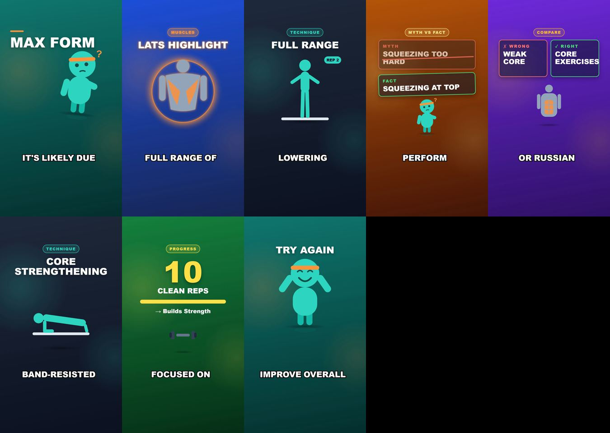 | 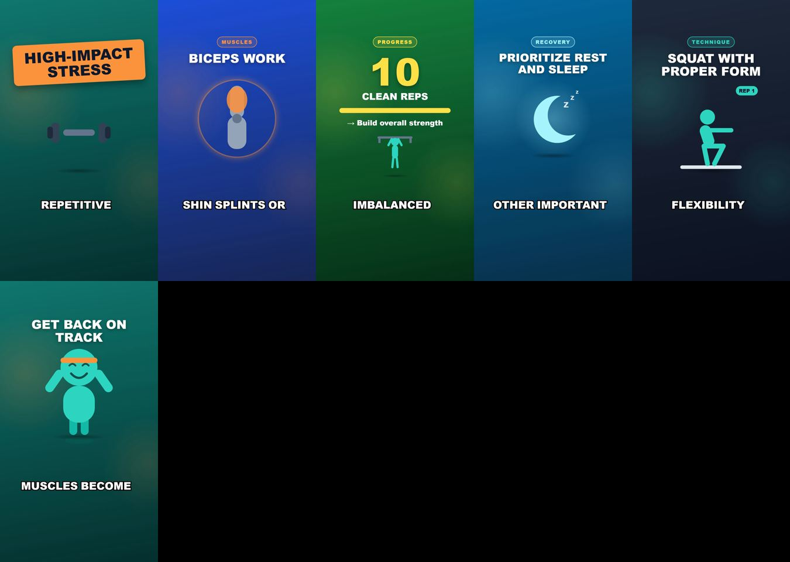 | 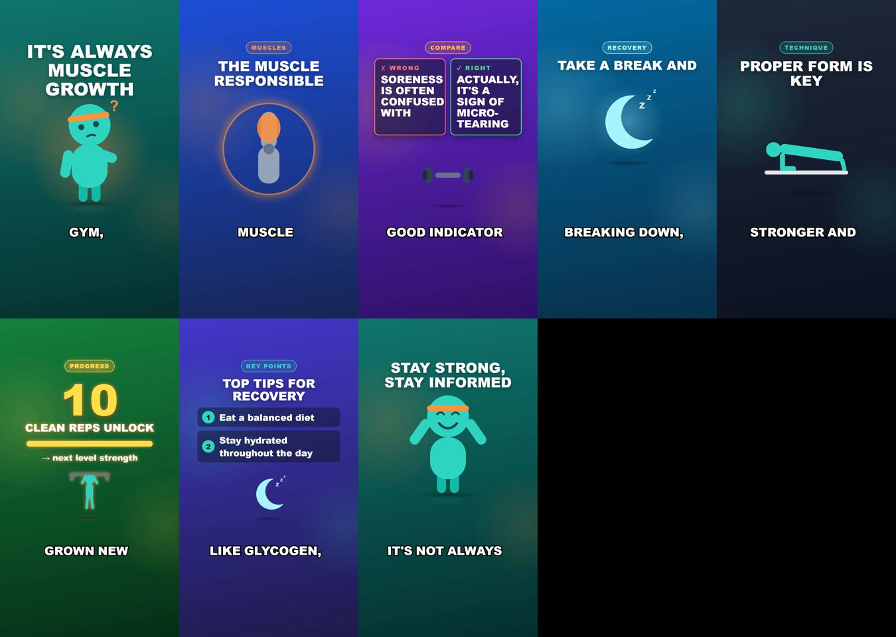 | 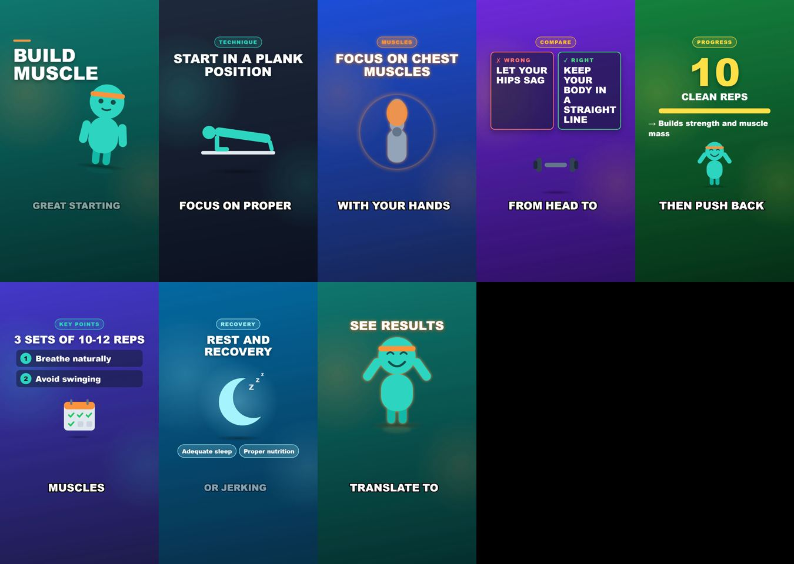 | 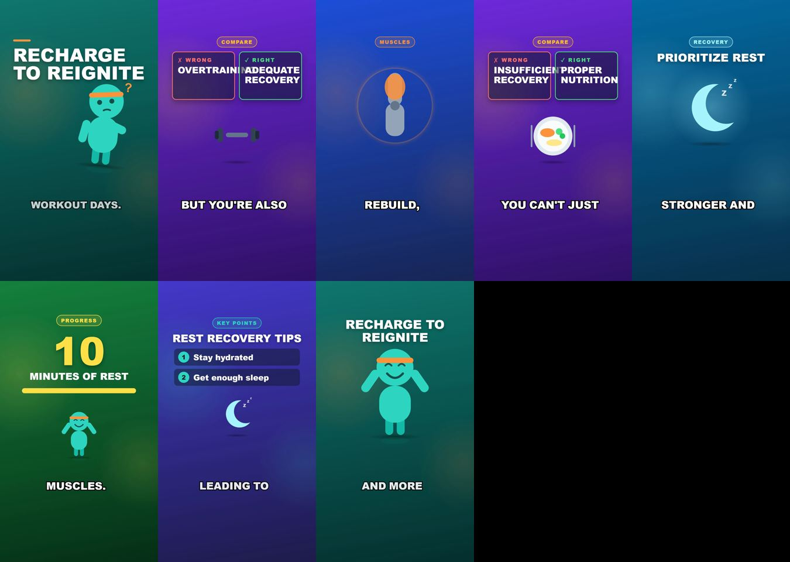 |

İnceleme bulguları:

| | Bulgu | Kaç videoda | Sınıf |
|---|---|---|---|
| S | Kokoro 49–62 sn (normalde ~10), render 61–78 sn (normalde ~24) | 4/5 | **Windows verimlilik modu** (bölüm 3) |
| A | AnatomyHighlight yanlış kas: koşuda "Biceps work", şınavda "chest" için biceps, dinlenmede boş metinli biceps | 4/5 | asset eşleştirme (bölüm 4) |
| E | Pull-up videosunda squat çizimi | 1/5 | asset eşleştirme (bölüm 4) |
| R | Planın 6 reddinin 6'sı asset tekrarı ("art arda aynı", "3 kez") | 4/5 | ~80 sn boşa LLM (bölüm 5) |
| C | "10 CLEAN REPS" birebir aynı | 3/5 | prompt'taki tek örnek kopyalanıyor (bölüm 6) |
| D | Hook "max Form" | 1/5 | yer tutucunun yarısı kopyalanmış (bölüm 6) |
| B | Comparison kartında "OVERTRAININ" / "INSUFFICIEN" kırpılıyor | 1/5 | renderer yerleşimi (bölüm 7) |
| F | Ay ikonlu Recovery sahnesi | 5/5 | kanal düzeyinde tekrar; içerik meşru, not edildi |

**Script ve olgusal ifade:** tıbbi tedavi iddiası yok, ifadeler temkinli ("can lead to", "not necessarily"). Push-up ve rest-days script'leri iyi. Zayıf noktalar: koşu videosu sorunun asıl konusu olan "kazanımlara etkisi"ne hiç değinmiyor (sakatlıklara kayıyor); soreness videosundaki "vücut onarımı glikojenle besler" ifadesi şüpheli. Bunlar 3B yerel modelin içerik sınırları; inceleme listesinin ilk maddesi ("Every claim is accurate...") tam olarak bunu yakalamak için var. Kodla "düzeltilmeye" çalışılmadı.

**Anlatım, zamanlama ve altyazılar:** ses ve altyazılar senkron (Day 12'nin ses zamanlı sahneleri); uzunluklar 32.9–40.1 sn, yani CLAUDE.md'nin 25–45 sn aralığında. Altyazılar tek satır, büyük ve okunur.

---

## 3. Sistematik sorun S: küçültülmüş pencerede 3 kat yavaş üretim (`Processes/FullSpeed.cs`)

Ölçüm:
```
render from pre-built bundle (normal shell)                     22,1s
render via the minimized-window API (generate.cmd'nin başlattığı) 61,1s    CPU yükü: %10
```

**Neden (kök sebep):** Windows 11, küçültülmüş ya da arka plandaki bir konsola bağlı süreçleri "arka plan işi" sayıp **EcoQoS** (verimlilik modu, güç kısıtlaması) ile çalıştırıyor. Bu, API'nin başlattığı Kokoro ve Remotion süreçlerini de etkiliyor. Makine sağlıklıydı (doğrudan render 22 sn), pil de yoktu (prizde, %100). Day 28'in `generate.cmd`'si API'yi tam da küçültülmüş bir pencerede başlatıyor; kullanıcı `start.cmd` penceresini küçültse aynı şey olurdu.

```csharp
var state = new PROCESS_POWER_THROTTLING_STATE { Version = 1, ControlMask = EXECUTION_SPEED, StateMask = 0 };  // "kısma: kapalı"
SetProcessInformation(process.Handle, ProcessPowerThrottling, ref state, size);
// VideoJobWorker başlarken: FullSpeed.ApplyToCurrentProcess();   ProcessRunner her çocuk için: FullSpeed.Apply(process);
```

**Nasıl çalışıyor:** `ControlMask`, "hız kısmasına ben karar veriyorum" diyor; `StateMask = 0` da "ve kısma kapalı" diyor. Bir video işi kullanıcının beklediği iş, dolayısıyla arka plan önceliğine düşmemeli. Eski Windows sürümlerinde bu bilgi sınıfı yoksa çağrı sessizce bir şey yapmıyor. Sonuç (aynı küçültülmüş pencere senaryosu): **61.1 sn → 24.7 sn**, CPU %10 → %51.

---

## 4. Sistematik sorun A ve E: asset eşleştirme (`AssetMatcher.Improve`)

Kök nedenler katalog verisi ile matcher'ın birleşimindeydi:
1. `biceps-highlight` / `triceps-highlight` **"muscle"** etiketine sahip, bu yüzden "chest muscles" veya "the muscle responsible" diyen her sahneyle "eşleşiyor"du.
2. `squat-top` **"top"** etiketine sahip; "squeezing your lats at the **top**" cümlesi yüzünden pull-up videosunda squat çizimi korunuyordu.
3. Gerçek etiket `"pullup"`, metin `"pull-ups"`: matcher metni `pull` + `up` diye bölüyor ve etiketle **hiç** eşleştirmiyordu. Matcher'ın testlerinde ise sahte katalog `"pull-up"` kullanıyordu: **testler geçiyordu, gerçek veri çalışmıyordu**.
4. Sahne cümlesinde ipucu yoksa videonun konusu dikkate alınmıyordu.

```csharp
private static readonly HashSet<string> GenericWords = { "top", "bottom", "position", "front", "standing", "depth", "hold", "muscle", ... };
// Score: bir etiket, anlamlı kelimelerinin hepsi metinde geçiyorsa sayılır (genel kelimeler sayılmaz)
// Words: her kelime + tireyle yazılmış her çift birleşik halde de ("pull-ups" -> pull, up, pullup)
var best = BestMatch(catalog, sceneType, sceneWords) ?? BestMatch(catalog, sceneType, Words($"{sceneText} {topic}"));
// AnatomyHighlight: sahne/konu hiçbir kası anmıyorsa çizim yok (renderer'ın nötr maskotu) - yanlış kas yanlış bilgi öğretir
```

**Neden:** Görsel, anlatılanı desteklemeli (CLAUDE.md §4: "scene changes that match the topic"). Koşu videosunda biceps göstermek izleyiciye yanlış bir şey öğretir; maskot ise tarafsız. Göğüs için ayrı bir anatomi çizimi yok, ama şınav çizimlerinin "chest" etiketi var ve AnatomyHighlight ile uyumlular, bu yüzden "chest muscles" sahnesi artık şınav çizimini gösteriyor (yeni çizim gerekmeden; Day 20'nin "iyi etiketlenmiş asset kod değişmeden kullanılır" ilkesi).

**Testler artık gerçek katalogla:** `AssetMatcherTests`'e `assets/manifests/assets.json`'ı okuyan 5 test eklendi, beş videonun gerçek sahne cümleleriyle. Dördü önce **kırmızı** görüldü: hatalar birebir yeniden üretildi. Eski bir test ("eşleşme yoksa modelin seçimini koru") AnatomyHighlight için bilinçli olarak değişti (artık maskot); aynı kural ExerciseDemo için korunuyor.

---

## 5. Sistematik sorun R: asset tekrarı kodda onarılıyor (`AssetMatcher.Spread`)

```
Scenes 1 and 2 both show 'biceps-highlight' ...          Scenes 6 and 7 both show 'meal' ...
Scenes 3 and 4 both show 'dumbbell' ...                  Scenes 2 and 3 both show 'plank' ...
Asset 'sleep' is shown in 3 scenes; ...                  (birinci turun 6 reddinin 6'sı)
```

```csharp
public static IReadOnlyList<Scene> Spread(IReadOnlyList<Scene> scenes, IReadOnlyList<AssetMetadata> catalog, string topic)
// sahne sırasıyla: önceki sahneyle aynı asset ya da 3. kullanım -> sahneye (yoksa konuya) uyan, serbest, uyumlu başka asset; yoksa [] (maskot)
```

**Neden:** Bu kural (Day 19) yalnızca ihlali tespit ediyordu; düzeltmeyi LLM'den 12–14 saniyelik yeni bir denemeyle istiyordu. 3B model ise bu kuralı sık bozuyor. Asset seçimini katalog verisiyle düzeltmek deterministik ve bedava. Kural zayıflamadı: onarılmış plan aynı `PlanVariationRules.Check`'ten geçiyor (test bunu doğruluyor). Tip çeşitliliği ve açılış dizisi gibi gerçekten yaratıcı kararlar hâlâ LLM'de.

---

## 6. Sistematik sorun C ve D: prompt'tan kopyalanan metinler (`ScenePlanPromptBuilder`)

```diff
-  * Progress: onScreenText contains a number (e.g. "10 clean reps"), secondaryText = what it unlocks.
+  * Progress: onScreenText = a number THIS scene's narration mentions plus what it counts
+    (max 4 words), secondaryText = what reaching it gives you.

-public const string OnScreenTextPlaceholder = "max 5 words";
+public const string OnScreenTextPlaceholder = "<caption>";          // tüm yer tutucular <...> içinde
+IsPlaceholder: text.Contains('<') || text.Contains('>') || köşeli parantezsiz haline eşit
```

**Neden:** Day 20'de ve Day 22'de de görüldüğü gibi, küçük model prompt'taki örnek metinleri içerik sanıp kopyalıyor. "10 clean reps" üç videoda birebir çıktı; bu da kanal düzeyinde tekrar demek. "max Form" ise yer tutucunun **yarısı** ile modelin bir kelimesinin karışımıydı; birebir eşleşme kontrolü (Day 22) bunu yakalayamazdı. Açılı parantezler gerçek bir ekran metninde hiç geçmediği için, kısmi bir kopya da "eksik" sayılıyor ve bilinen yedek değerler devreye giriyor. Örnek yerine biçim tarif ediliyor ("sahnenin kendi sayısı + neyi saydığı").

---

## 7. Sistematik sorun B: kartta taşan uzun kelimeler (`renderer/src/scenes/templates/fit.ts`)

```ts
export function fitFontSize(text: string, availableWidthPx: number, baseSize: number, minSize: number): number {
  const longestWord = Math.max(0, ...text.split(/\s+/).map((word) => word.length));
  const fitting = Math.floor(availableWidthPx / (longestWord * EM_PER_CHAR));   // EM_PER_CHAR = 0.6
  return Math.max(minSize, Math.min(baseSize, fitting));
}
// Card: fontSize: fitFontSize(text, width - 78, 62, 34)    // 78 = 2 x 34 padding + 2 x 5 kenarlık
```

**Neden / Nasıl çalışıyor:** Kelimeler ortadan bölünmüyor, bu yüzden sığıp sığmamayı **en uzun kelime** belirliyor. Kırpılan kelime karakter başına yaklaşık 0.54em gösterdi; geniş harfler (M, W) için 0.6 kullanılıyor. Fonksiyon saf: aynı metin her karede aynı boyutu veriyor (Remotion'ın deterministik render şartı) ve DOM ölçümü gerektirmiyor. Okunabilirlik için alt sınır 34 px.

---

## 8. İkinci ve üçüncü tur: düzeltmeler işe yaradı, yeni sorunlar çıktı

| Run 2 | | | | |
|---|---|---|---|---|
| 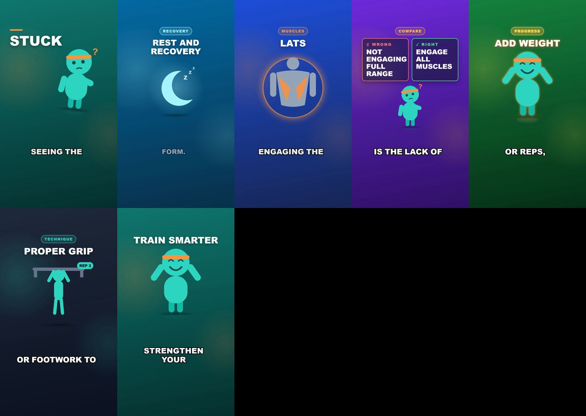 | 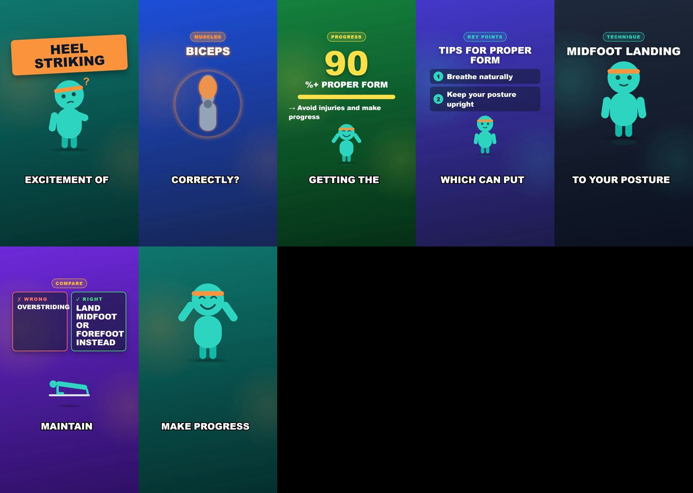 | 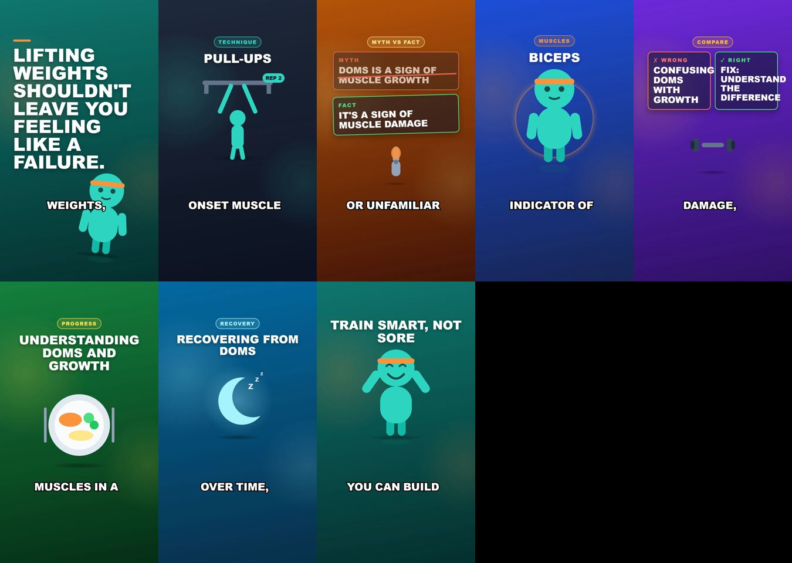 | 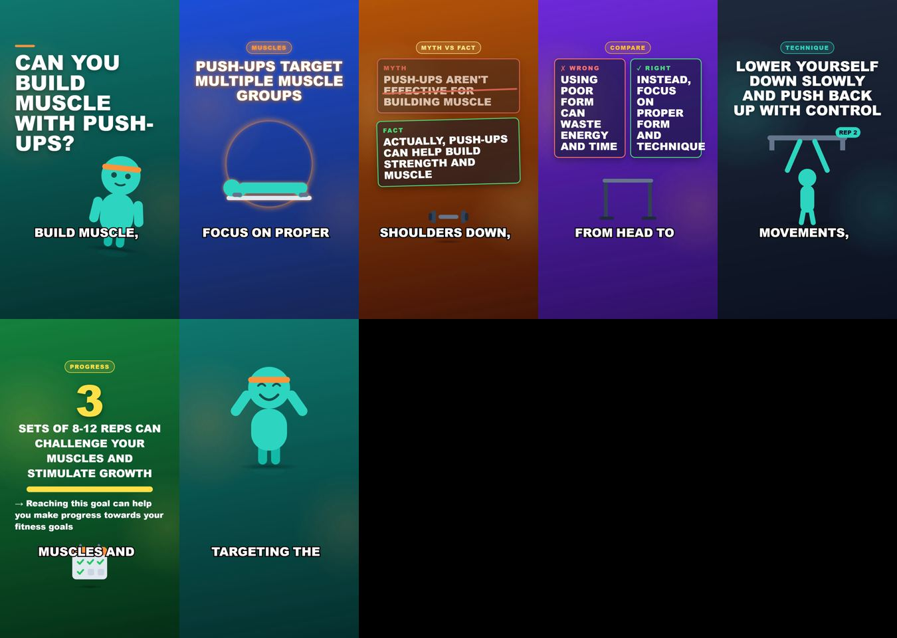 | 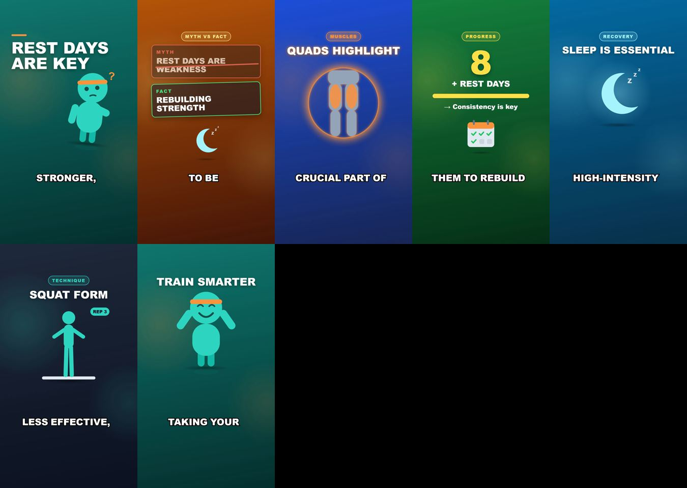 |
| **Run 3** | | | | |
| 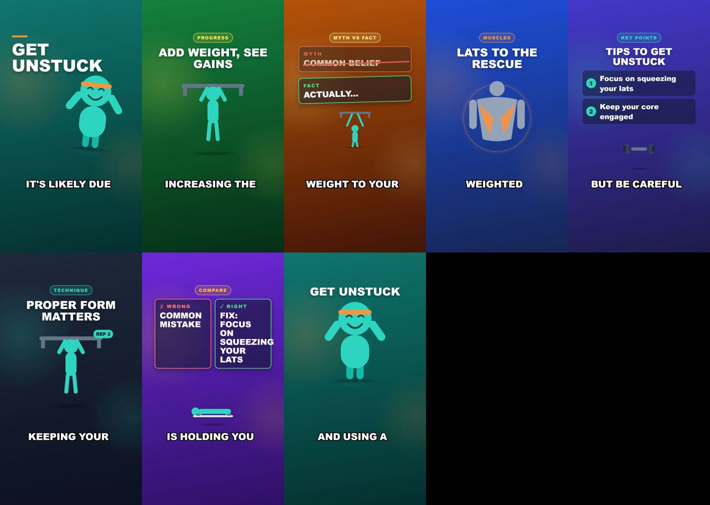 | 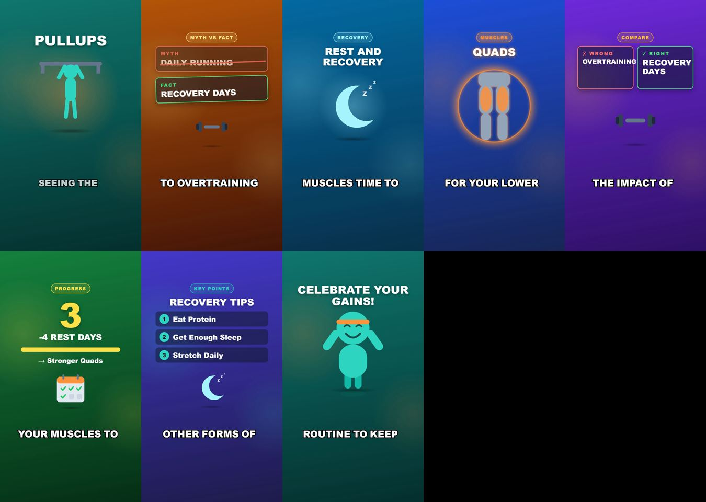 | 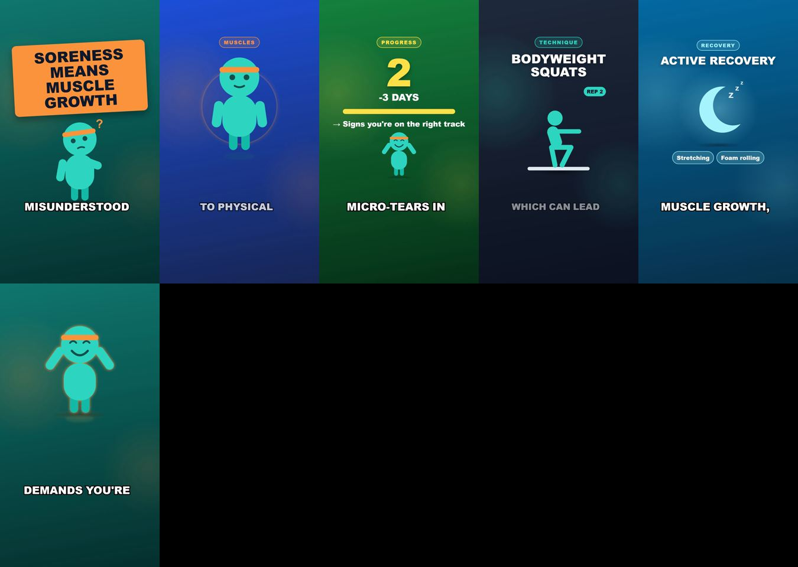 | 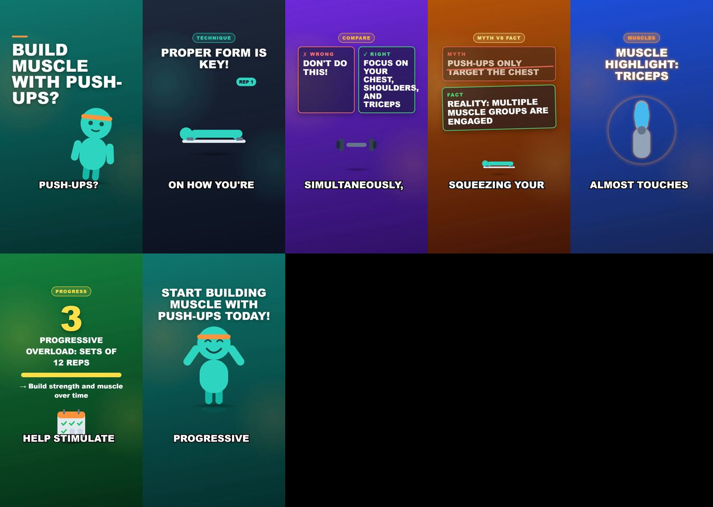 | 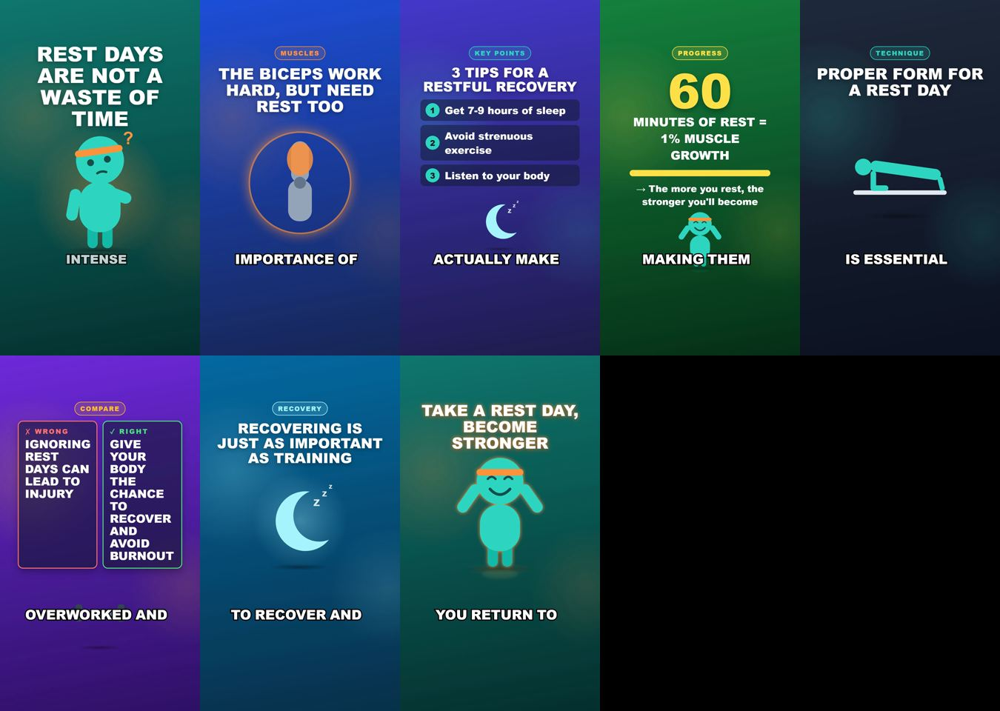 |

İşe yarayanlar: pull-up videosunda yalnızca pull-up çizimleri var; "chest muscles" sahnesi şınav çizimini gösteriyor; uzun kelimeler kartlara sığıyor; "10 clean reps" ve "max …" sızıntısı yok; **10 videoda asset tekrarı kaynaklı plan reddi sıfır** (birinci turda 6).

Yeni bulunanlar ve düzeltmeleri:
* **"push back up" pull-up'a eşleşti** (şınav videosunda pull-up çizimi): ExerciseDemo'da konu bir egzersizi adlandırıyorsa ve sahne başka bir egzersizi adlandırmıyorsa, konunun egzersizi gösteriliyor. Bunun için "ilk etiket = konu" katalog kuralı `docs/ASSETS.md`'ye yazıldı. Test önce kırmızı görüldü.
* **Model "en fazla 5 kelime" kuralını bazen hiç dinlemiyor**: 10 kelimelik bir Hook maskotun ve altyazının üstüne taşıyordu, 12 kelimelik bir Progress etiketi kartından taşıyordu. `fit.ts`'e `estimateLines` ve `fitBlockFontSize` eklendi: blok N satıra (başlıklar 3, Progress 2) sığana kadar küçülüyor. Headline, iki Hook düzeni ve Progress'te kullanılıyor. Son turda bir başlık tahmin edilen 3 yerine 4 satıra düştü; satır tahmini için katsayı 0.6'dan 0.7'ye çıkarıldı (kelimeler bütün olarak alt satıra geçtiği için satırlar nadiren tam doluyor).

---

## 9. En ciddi bulgu: ekranda uydurma sayılar (`Domain/OnScreenNumbers.cs`)

15 videonun 25 sahnesinde ekranda, sahnenin anlatımında **hiç geçmeyen** sayılar vardı:
```
Rest Days: The Secret to Strength  scene 4 (Progress): shows '60', '1%'  -- narration: When you rest, your muscles have time to repair and rebuild...
Is Running Killing Your Gains?     scene 3 (Progress): shows '90%'       -- narration: Proper form is key to avoiding injuries...
```
"60 minutes of rest = 1% muscle growth" ekranda bir **olgu** gibi görünüyor. Prompt "a number THIS scene's narration mentions" diyordu; model uymadı.

```csharp
public static IReadOnlyList<string> Unsourced(Scene scene)   // ekrandaki (başlık, ikinci metin, maddeler) sayılardan anlatımda geçmeyenler
// anlatımdaki sayı kelimeleri de sayılır: "three to five" = 3-5, "twice" = 2, "half" = 50 ...
public static Scene Strip(Scene scene)                        // kaynaksız sayı içeren alanlar ekrandan kaldırılır
```

**İki katman:**
1. **Yumuşak kural** (`CheckOnScreenNumbers`): reddetme nedeni modele geri gidiyor ("Scene 4 shows 60, 1% on screen, but its narration never says that number…"). Prompt'a da açık bir kural eklendi.
2. **Kesin güvenlik ağı**: denemeler bittiğinde hâlâ kaynaksız bir sayı varsa o metin ekrandan **kaldırılıyor** (sahne altyazı ve görselle devam ediyor), sayısı kaldırılan bir `counter` animasyonu `pop`'a dönüyor, ve `review.md` "that text was removed from the screen" diyor. Uydurma bir istatistik hiçbir yoldan ekrana çıkamıyor.

**Neden kod, prompt değil:** Bu bir güvenlik kuralı (CLAUDE.md §4). Küçük bir modelin talimata uymasına güvenmek yeterli değil, kural deterministik bir kontrolle garanti edilmeli. Bedeli var ve ölçüldü: son turda planların çoğu 3 denemede kabul edildi (model sayı uydurmakta ısrar etti; bir planda "80%, 20%"). Video başına 54–100 sn. Doğruluk için kabul edilebilir.

Testler: `OnScreenNumbersTests` (8, gerçek metinlerle: uydurma istatistik yakalanıyor; "3 sets of 8-12", "three to five seconds" → "3-5", "seven to nine hours", "one rep" → "+1", "90 seconds" geçiyor; maddeler ve ikinci metin de kontrol ediliyor; `Strip` yalnızca sorunlu alanları kaldırıyor). Planlama testi: model üç denemede de uydursa bile metin kaldırılıyor ve uyarı "removed from the screen" diyor. Test yardımcısının varsayılan ekran metni "Scene 3"ten "Scene C"ye değişti (artık rakam içeren her metin bir iddia).

---

## 10. Hız: küçültülmüş pencere düzeltmesi ve hâlâ açık olan soru

`FullSpeed` (bölüm 3) API'ye ve doğrudan çocuklarına (node, python) uygulanıyor; `GetProcessInformation` ile doğrulandı (`control=1 state=0`). Ama Chrome render süreçleri node'un çocukları ve onlarda karar Windows'ta (`control=0`). Ölçümler:
```
Hidden / Normal / Minimized pencere (yeni başlatılmış API)   24,5s / 24,5s / 24,5s
Aynı API ~15 dakika sonra (12:55'te başlatılmış)               57,7s  (CPU %16)
Üçüncü ve son tur (yeni API, 5 + 5 video)                      Kokoro 10-12s, render 23-28s - normal
```
Yavaşlık pencere türüne değil, bir **zamana ya da bir duruma** bağlı görünüyor: bir süre çalışan API'de ortaya çıkıyor, yeniden başlatınca geçiyor. Kesin kök neden bulunamadı (kullanıcının bilgisayar başında olup olmaması, Windows'un arka plan sezgisi gibi olasılıklar var). **Bilinen sorun** olarak kaydedildi: görülürse API'yi yeniden başlatmak çözüyor (`tools/perf/measure-render.ps1` ile ölçülebilir). Olası kalıcı çözüm, Chrome torun süreçlerine de `FullSpeed` uygulamak, Day 30 / Phase 2 adayı.

---

## Doğrulanan davranış

```
$ dotnet test   -> Domain 124, Application 145, Infrastructure 116, Api 27   (toplam 412; Day 28: 394)
$ npm test      -> 64/64     $ npm run lint -> temiz     $ npm run smoke -> SMOKE OK
```

**Son beş video** (kabul kriteri: "five playable distinct Shorts"), ffprobe:
```
Why Your Pull-Ups Aren't Increasing      1080x1920 h264 30/1fps audio=aac 43,3s   "Unlock Your Full Pull-Up Potential"
Is Running Killing Your Gains?           1080x1920 h264 30/1fps audio=aac 35,1s   "Don't Let Running Hold You Back"
Why Soreness Doesn't Mean Muscle Growth  1080x1920 h264 30/1fps audio=aac 35,1s   "Sore Doesn't Mean Stronger"
Can You Build Muscle With Push-Ups?      1080x1920 h264 30/1fps audio=aac 33,2s   "Can You Build Muscle with Push-Ups?"
Why Rest Days Make You Stronger          1080x1920 h264 30/1fps audio=aac 39,0s   "Rest Days: The Secret to Building Strength"
ekranda kaynaksız sayı: 0
```

| Pull-ups | Running | Soreness | Push-ups | Rest days |
|---|---|---|---|---|
| 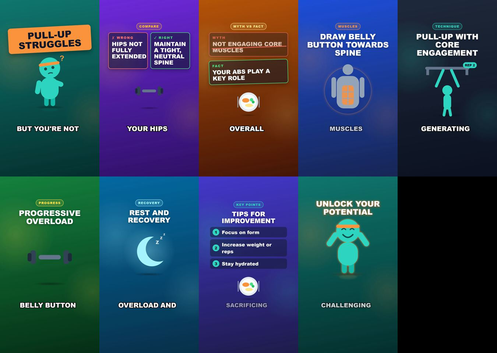 | 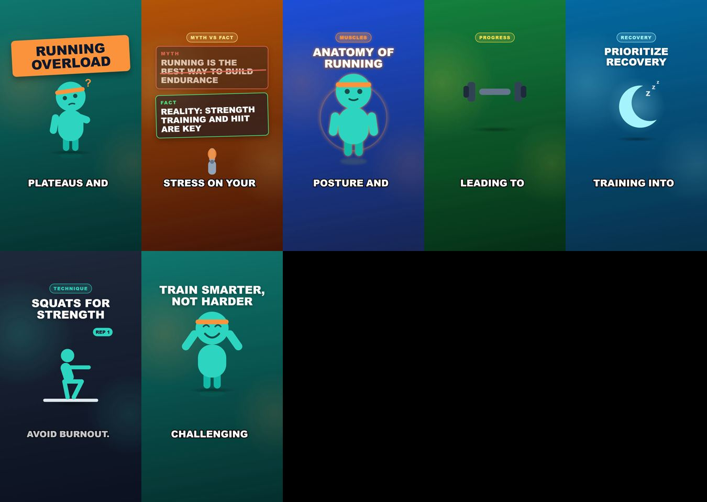 | 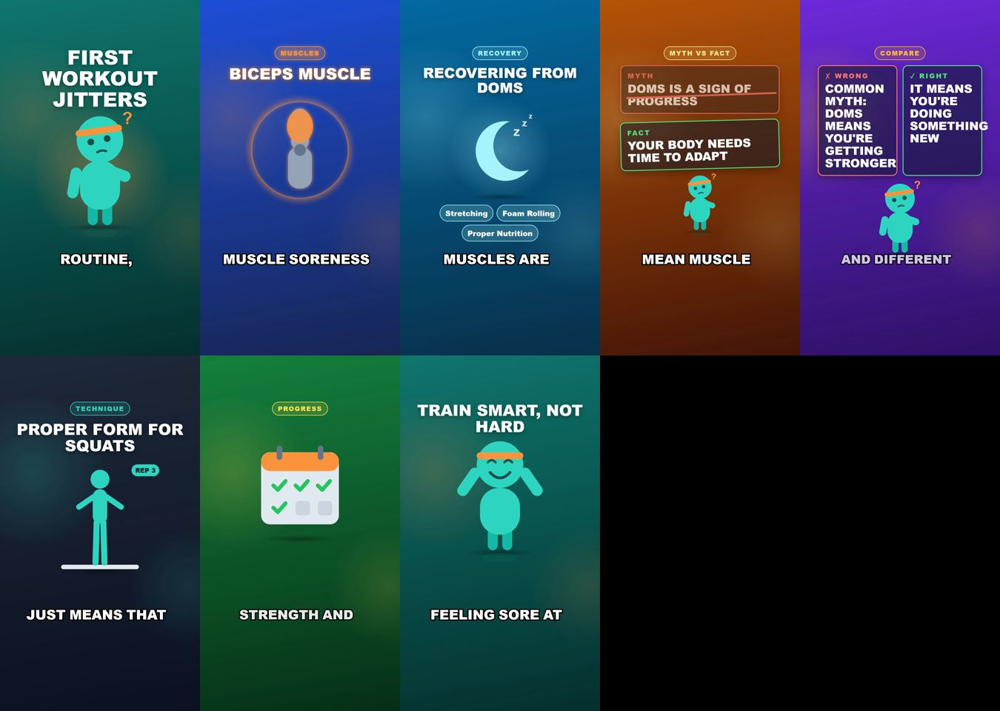 | 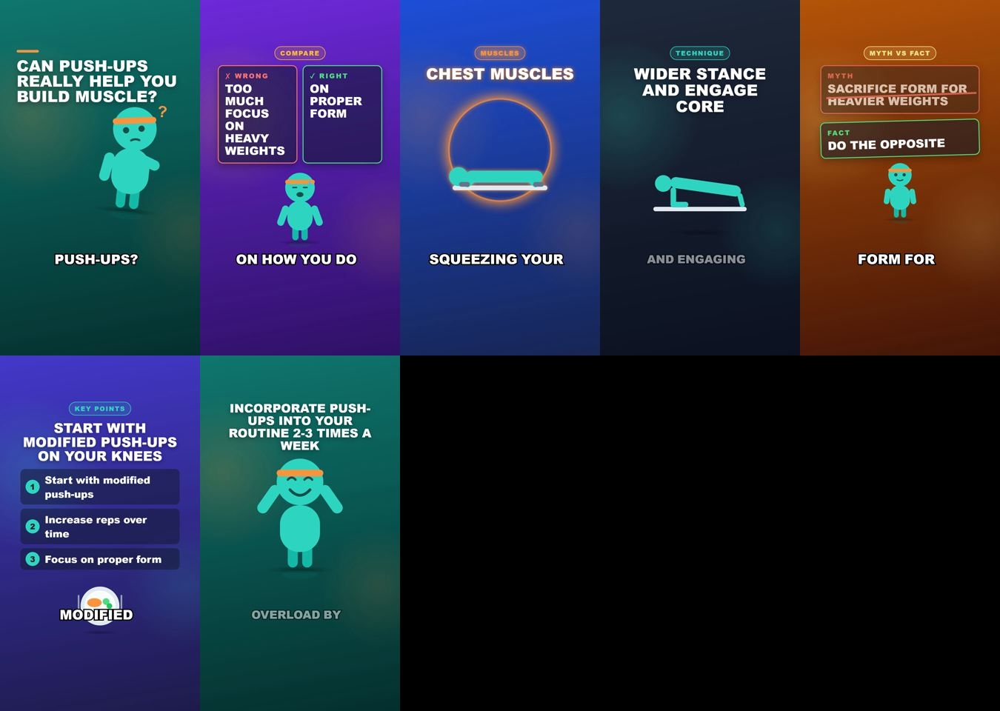 | 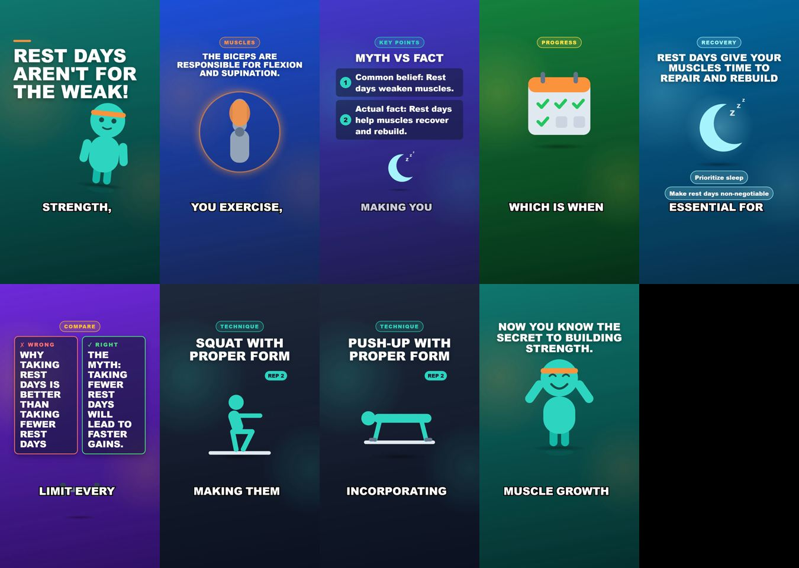 |

Videolar `output/INDEX.md`'de listeleniyor; hiçbiri "Reviewed" değil, çünkü onları bir insanın (senin) izlemesi gerekiyor.

## İnsan incelemesine kalanlar (kod değil, modelin içerik sınırı)
* Bazı ekran etiketleri anlatımla tam uyuşmuyor ("BICEPS MUSCLE" soreness videosunda, "QUADS"); 3B model bunları kendisi yazıyor.
* Koşu videosu sorunun asıl konusuna ("kazanımlar") az değiniyor; bazı mitler zayıf kurulmuş.
* Her videoda bir Recovery/ay sahnesi var: içerik olarak meşru, ama kanal düzeyinde tekrar hissi verebilir.
* Bu turlar sırasında aynı beş konuda 20 video üretildi; açılış dizisi kuralı bu yüzden normalden sık tetiklendi.
