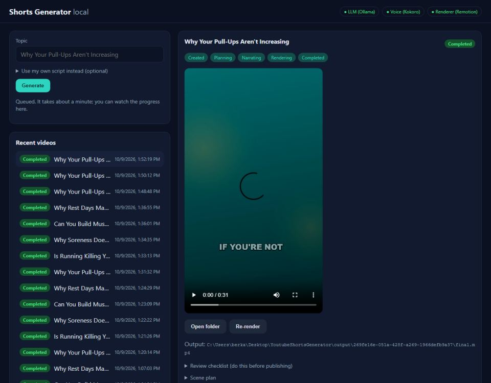
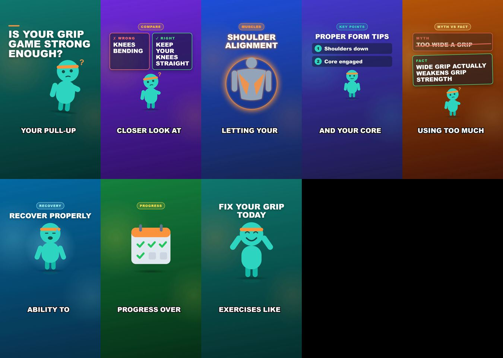

# Day 30 — Kod Notları

30 günlük roadmap, Gün 30. Konu: V1 sonlandırma. Son belgeler (README, mimari, yapılandırma, sorun giderme, lisanslar), depo temizliği, bütün testler, CLAUDE.md §19'daki V1 tanımına karşı baştan sona taze bir üretim, ve Phase 2 seçeneklerinin **önerilmesi** (uygulanmadan).

Bu doküman, bugün eklenen/değişen her parçayı **yazılma/kullanılma sırasına göre** gezer.

---

## 1. Depo temizliği: `.gitignore` → `.remotion/`

```gitignore
# Remotion's downloaded headless Chrome (~280 MB), wherever a script was run from
.remotion/
```

**Neden:** Kök dizinde 289 dosyalık, 281.6 MB'lık bir `.remotion/chrome-headless-shell` klasörü vardı. Bir tarayıcı testi kök dizinden çalıştırıldığında Remotion onu oraya indirmiş. Bu, tekrar indirilebilen bir önbellek: silinmedi (scriptler kullanıyor), ama commit'e girmemesi için yok sayıldı. Diğer üretilen her şey (output/, *.db, node_modules/, tools/tts/models/, renderer/out/) zaten yok sayılıyordu.

---

## 2. Belgeler

| Dosya | İçerik |
|---|---|
| `README.md` | baştan yazıldı: ne yapar, hızlı başlangıç, kurulum, nasıl çalışır, API, belge haritası, testler |
| `docs/ARCHITECTURE.md` | Day 1'deki taslağın yerine gerçek mimari: bileşen şeması, proje sınırları, bir işin yaşamı ve durum makinesi, plan.json sözleşmesi, diskteki dosyalar, günleriyle önemli kararlar |
| `docs/CONFIGURATION.md` | her ayar, varsayılanı ve anlamı (ölçülmüş değerlerle: keep-alive, concurrency tablosu, 127.0.0.1 nedeni); `Section__Key` ortam değişkeni kuralı; bilerek ayar olmayan ürün kuralları |
| `docs/TROUBLESHOOTING.md` | gerçek hata mesajları → nedeni → çözümü (hepsi bu 30 günde gerçekten görülen mesajlar) |
| `docs/LICENSES.md` | projenin kendi asset'leri, araçlar ve modeller, içerik notları |
| `docs/PHASE_2_OPTIONS.md` | öneriler: ücretsiz (A) ve ücretli (B) seçenekler, kanıtları, bedelleri ve tuzakları |

**Lisans kontrolünden çıkan iki önemli gerçek** (kurulu sürümlerin kendi lisans dosyalarından okundu, tahmin edilmedi):
* **Remotion** ücretsiz, ama yalnızca bireyler ve en fazla 3 çalışanlı şirketler için (ticari kullanım dahil). Daha büyük şirketler için şirket lisansı gerekiyor. Remotion'ın bir türevini **satmak yasak**; bu, Phase 2'deki "SaaS'a dönüştürme" seçeneğini doğrudan etkiliyor.
* **phonemizer / espeak-ng** (Kokoro'nun telaffuz katmanı) GPL-3.0. Yerel kullanımda sorun yok; TTS kurulumu paketlenip dağıtılırsa GPL yükümlülükleri doğar.

---

## 3. Bulunan ve düzeltilen: test scriptindeki yarış (`renderer/scripts/dashboard-smoke.mjs`)

İlk V1 denemesinin çıktısı:
```
job finished after 1 s: Completed
Error: Timed out waiting for: the video element to load
```
**Neden:** Script yeni işi listede **konu adına göre** buluyordu. Day 29'dan aynı başlıklı tamamlanmış videolar kaldığı için eski bir "Completed" iş seçili kalmış ve script onun rozetini okumuştu. Gerçek iş arka planda normal şekilde çalışıyordu (`Planning`, running). Day 21'de konu ilk kez kullanıldığı için hata hiç görünmemişti. Uygulamada bir hata yoktu; test kendi varsayımı yüzünden yanlış sonuç veriyordu.

```js
const jobId = await page.evaluate(async () => (await (await fetch("/api/videos?take=1")).json())[0].id);
await waitFor("the new job selected", () => document.querySelector("#jobs li:first-child")?.classList.contains("selected"), 15000);
// durum API'den (gerçek), ekrandaki rozetle birlikte bekleniyor
```

---

## 4. Bulunan ve düzeltilen: model hiç asset seçmediğinde "konunun egzersizi" kuralı devre dışı kalıyordu (`AssetMatcher`)

Taze V1 videosunda pull-up konusunun ExerciseDemo sahnesinde ("start with your feet shoulder-width apart and engage your **core**") **plank** çizimi vardı. Day 29'da eklenen kural yalnızca modelin bir asset seçtiği durumda çalışıyordu (`current is not null`). Model hiçbir şey seçmeyince en iyi eşleşme "core" üzerinden plank'ı getiriyordu.

```csharp
public static IReadOnlyList<string> Improve(...)
{
    var choice = Choose(chosen, sceneType, sceneText, sceneWords, catalog, topic);      // eski mantık, aynen
    return sceneType is SceneType.ExerciseDemo ? PreferTopicExercise(choice, sceneWords, catalog, topic) : choice;
}
// PreferTopicExercise: seçim (boş dahil) sahnede adıyla geçmiyorsa ve konu bir egzersizi adlandırıyorsa -> konunun egzersizi
```

**Nasıl çalışıyor:** Kural, seçimin hangi yoldan geldiğinden bağımsız olarak, **son adım** olarak uygulanıyor. Yeni test (`Real_TheTopicsExercise_AlsoWinsWhenTheModelChoseNothing`) bu sahnenin gerçek cümlesini kullanıyor. Eski kodda bu yolun kuralı atladığı kod okunarak görüldü (`current is not null` koşulu); test bu kez düzeltmeden önce ayrıca kırmızı çalıştırılmadı.

---

## 5. V1 tanımı (CLAUDE.md §19): taze, baştan sona üretim

Son kod değişikliğinden sonra, dashboard üzerinden, gerçek bir tarayıcıyla:

```
1. start.cmd -CheckOnly        -> 7 x [OK], "All set."
2. start (API) + dashboard      -> http://localhost:5007
3-4. "Why Your Pull-Ups Aren't Increasing" yazıldı, Generate
after 1009 ms: "Queued. It takes about a minute; you can watch the progress here."
job 269fe16e-051a-428f-a269-1966defb9a37
job finished after 83 s: Completed
video element: {"duration":31.168,"width":1080,"height":1920}
5. job.log: plan attempt 3 (Recovery art arda + uydurma sayı reddedildi), Kokoro 31.18s ses / 10.6s, render 24.7s
   ffprobe: h264 1080x1920 + aac, 31.168s
6. output/269fe16e-…/final.mp4  (+ plan.json, narration.wav, review.md, job.log, final.inputs.sha256)
8. Ücretli servis: yok (Ollama, Kokoro, Remotion hepsi yerel)
```




**7. madde ("only optional minor human polish"):** görsel olarak video hazır: altyazılar okunur, başlıklar taşmıyor, uydurma sayı ekrandan kaldırılmış (Progress sahnesi yalnızca takvimi gösteriyor). Script'in içeriği ise insan gözüyle kontrol edilmeli: "too much grip strength ... can actually decrease your ability to pull" ifadesi şüpheli, ve ilk denemedeki script "resistance band to **increase** the load" diyordu (bant yükü azaltır). Bunlar 3B yerel modelin içerik sınırları. V1 bunu bilerek bir **insan inceleme adımıyla** karşılıyor (CLAUDE.md §4) ve inceleme listesinin ilk maddesi tam olarak budur. Kalıcı çözüm, Phase 2'deki A1 (daha büyük yerel model) ve A6 (editör prompt'u).

---

## Doğrulanan davranış

```
$ dotnet build      -> 0 Uyarı, 0 Hata
$ dotnet test       -> Domain 124, Application 146, Infrastructure 116, Api 27   (toplam 413)
$ npm test          -> 64 passed (64)
$ npm run lint      -> temiz (eslint + tsc)
$ npm run smoke     -> SMOKE OK (9 sahne tipi gerçek Chrome'da, bozuk plan alan adıyla reddedildi)
V1 akışı (yukarıda) -> Completed, 1080x1920 h264+aac 31.2s, 83 sn
```

Bu sonuçlar CLAUDE.md'nin V1 tanımını karşılıyor. Kullanıcı yerel önkoşulları başlatıp arayüzden konuyu girerek, ücretli hiçbir servis kullanmadan, `output/<job-id>/final.mp4`'te oynatılabilir bir Short alıyor. Yayından önceki son söz insanda.

## Açık kalanlar (DAY_STATE'te de)
* Uzun süre çalışan bir API'de zaman zaman görülen 2-3 kat yavaş render (Chrome torun süreçleri; yeniden başlatma çözüyor). Phase 2 A3.
* Ölçüm ve test turlarından kalan ~40 taslak iş ve aynı konulardan ~20 örnek video: dashboard listesi kalabalık. **Silinmedi**; silmek geri alınamaz ve senin kararın.
